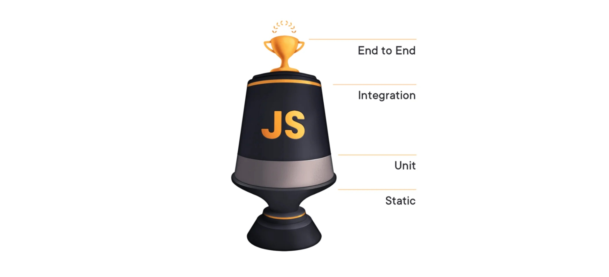

# 测试分类

## 概述

+ 静态测试
+ 单元测试
+ 集成测试
+ E2E 测试

  

## 静态测试

+ 静态测试不会涉及到具体的代码的运行，它是在编写代码期间对代码进行一个检查和分析，捕获写代码时可能出现的语法错误或者错别字

+ 对于前端开发人员来讲，静态测试更倾向于使用 typescript 或者 ESlint 之类的静态检查工具，在编写代码时候就能够提示错误

  ```js
  // 使用 ESLint 的 for-direction 规则能让你更早的发现问题
  for (var i = 0; i < 10; i--) {
    console.log(i)
  }

  const two = "2";
  // 使用 typescript 的静态检查功能也是能够提前发现问题
  const result = add(1, two);
  ```

## 单元测试

+ 单元测试往往是验证某一个单独的部分是否能够正常的工作，它是我们软件测试中的最小测试单位，通常是一个函数或者一个方法
+ 单元测试往往是由开发人员来编写一个一个的测试用例，通过一些自动化的工具来进行测试

  ```js
  // 这是一个函数，该函数是对传入的两个参数做相加操作
  function calculateSum(a, b) {
    return a + b;
  }

  // 接下来我们要对上面的函数进行一个测试
  describe("calculateSum", function() {
    // 这个就是一个测试用例
    it("should add two numbers correctly", function() {
      expect(calculateSum(1, 2)).toEqual(3); // 期望传入 1，2 的时候得到的值为 3
      expect(calculateSum(3, 4)).toEqual(7); // 期望传入 3，4 的时候得到的值为 7
    });
  });
  ```

+ 单元测试由于是对一个函数或者方法进行测试，是独立的一个单元，因此在进行单元测试的时候，往往会屏蔽发送请求，连接数据库等功能，这些功能一般都通过 mock （模拟）的形式来实现

## 集成测试

+ 所谓集成测试，就是将多个单元组装起来一起进行测试，主要是看这些单元在一起的时候是否能够正常工作，也就是说，集成测试的目的是确保整个系统中各个部分连接起来是能够正常工作的

+ 到了集成测试的时候，就会连接真实的数据，发送真实的网络请求，确保它们在协作的时候能够正常的工作

+ 下面是一个集成测试的例子：

  ```js
  // Express 里面的一个集成测试的示例
  const request = require("supertest");
  const app = require("./app");

  describe("User API", function() {
    let userId;
    // 测试用例
    // 测试添加新的用户，测试的是一个功能，涉及到发送真实的请求
    it("should add a new user", function(done) {
      request(app)
        .post("/users")
        .send({ name: "Alice", email: "alice@example.com" })
        .expect(201)
        .end(function(err, res) {
          if (err) return done(err);
          userId = res.body.id;
          done();
        });
    });
    // ...
  });
  ```

## E2E测试(端到端测试)

+ End To End，翻译成中文就是端到端的测试
+ 这种测试就会测试整个软件系统的功能以及完整性，这种测试会去模拟用户的行为和软件进行一个交互，相比集成测试，E2E测试会测试更加完整的功能，更像是一个真实的用户在和软件进行交互

+ 下面使用一个 E2E 测试的示例：

  ```js
  import {generate} from 'todo-test-utils'

  describe('todo app', () => {
    it('should work for a typical user', () => {
      const user = generate.user()
      const todo = generate.todo()
      cy.visitApp()
      cy.findByText(/register/i).click()
      cy.findByLabelText(/username/i).type(user.username)
      cy.findByLabelText(/password/i).type(user.password)
      cy.findByText(/login/i).click()
      cy.findByLabelText(/add todo/i)
        .type(todo.description)
        .type('{enter}')
      cy.findByTestId('todo-0').should('have.value', todo.description)
      cy.findByLabelText('complete').click()
      cy.findByTestId('todo-0').should('have.class', 'complete')
    })
  })
  ```

+ 上面的代码描述了一个完整的流程，从打开应用程序到注册用户、创建待办事项、完成待办事项、直到最终验证应用程序的状态，这就是一个典型的 E2E 测试，它会验证整个应用程序的功能和用户体验
