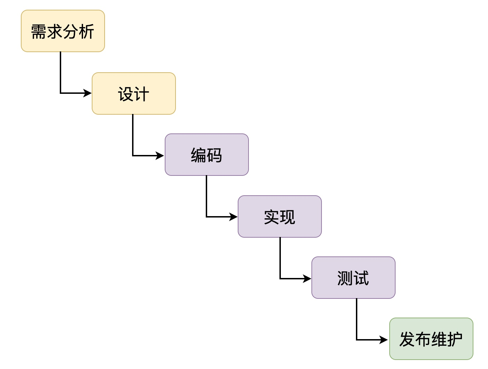
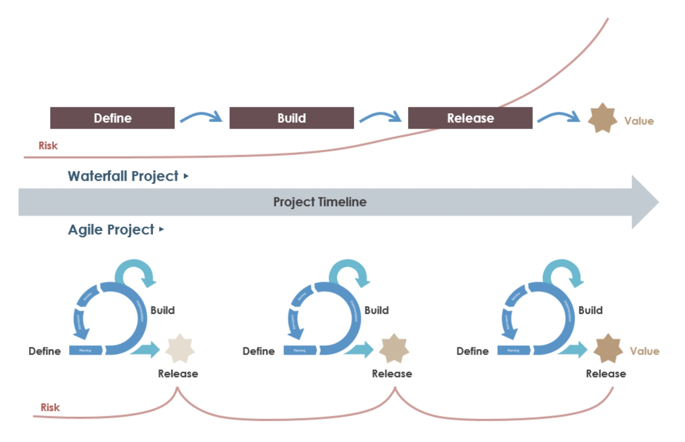
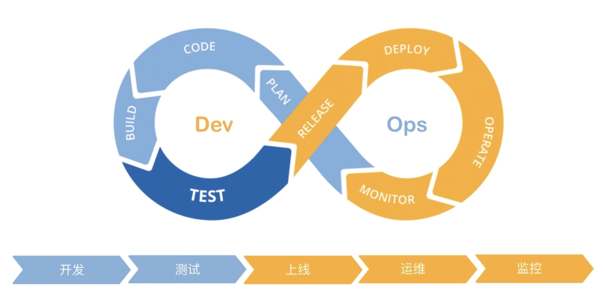

# 开发模型

## 分类

+ 瀑布开发模型
+ 敏捷开发模型
+ DevOps开发模型

## 瀑布开发模型

+ 这个是最早期就存在的一种模型，整个瀑布模型由以下几个阶段组成：

  + 需求分析：在进行软件开发之前，首先第一步就是做需求分析，明确要开发的软件有哪些需求，最终形成需求文档
  + 设计：需求分析完之后，接下来就是设计阶段，设计是多方面的

    + 界面设计：UI设计师会根据需求文档来设计界面
    + 程序设计：模块如何划分，有哪些接口，基本业务的处理流程

  + 编码与实现：根据设计好的方案，通过编码去实现
  + 测试：根据所书写的代码，去做功能上的测试
  + 发布与维护：发布上线，并且持续的维护产品

  

+ 瀑布模型作为整个软件开发模型中最最早期的一个模型，是一个非常经典的模型，后面的模型都是基于瀑布模型的基础上做了一定的变化产生的

## 敏捷开发模型

+ 敏捷开发模型是一种从 90 年代开始逐渐引起广泛注意的新型软件开发模式，这种模式主要是用于应对需求频繁变化和需要快速开发的场景

+ 瀑布模型和敏捷开发模型的区别：

  + 在敏捷开发模型中，软件开发会被分解为一系列短周期的迭代，每个迭代都包括需求分析、设计、编码实现、测试和部署，开发团队在迭代过程中会不断的和客户进行沟通和交流，随时根据客户的反馈进行方案的调整，保证软件开发方向上面的正确性

  

## DevOps开发模型

+ Dev英语全称为 Development（开发），Ops英语全称Operations（运维），DevOps 基本上就涵盖一个软件开发中的各个阶段

+ 在 DevOps开发模型，我们要做的就是通过自动化来实现软件的交付流程，让整体的构建、测试、发布都更加的快速，频繁

  + 持续开发：软件不断开发的阶段，整个软件交付的结果会被拆分成多个短周期的任务，每个任务完成之后立马进行交付
  + 持续测试：这里就会用到一些自动化测试工具，对上一个步骤中开发所涉及的代码进行测试，自动的跑一遍测试用例
  + 持续集成：测试通过之后，将新的代码集成到现有的软件里面
  + 持续部署：新的代码已经集成进去了，接下来就是将新集成的代码进行一个部署，部署到各个环境里面。
  + 持续监控：部署上线之后，我们需要对部署的代码进行一个持续的监控操作，以避免部署的代码出现任何的问题

  
