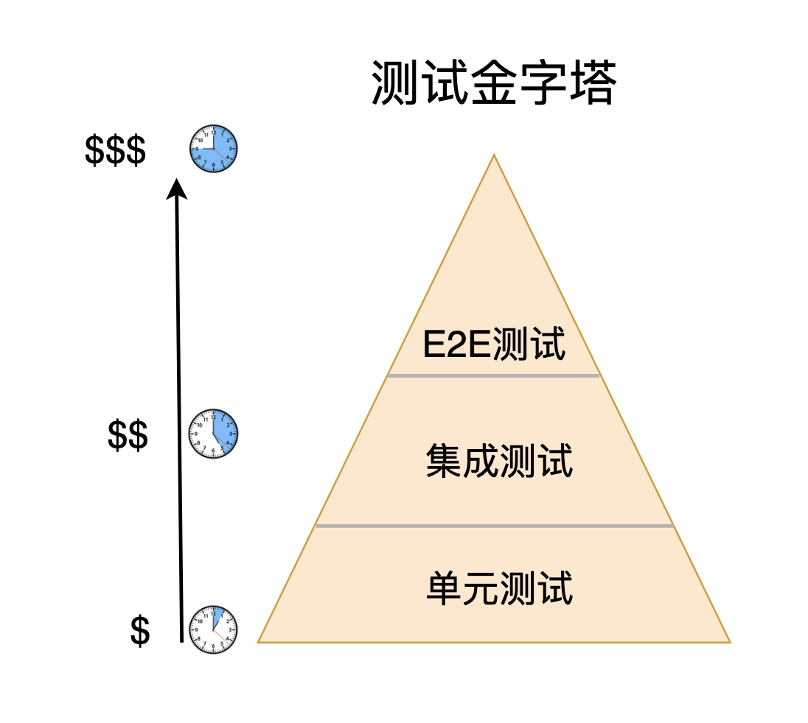

# 前端自动化测试

## 单元测试

+ 不同的测试这里会形成一个测试金字塔：

  

+ 一般来讲，软件开发中单元测试是做的最多的

  + 从测试金字塔的角度来看，越往上测试的成本是逐渐增加的，因为越到后期才抛出的 Bug，程序员要修复这个 Bug 所投入的精力和时间就会越多，另外越往上测试的运行速度越是逐渐增加

## 单元测试有点

+ 单元测试相比其他两种测试，有如下的优点：

  + 写起来是最容易的
  + 运行速度是最快的
  + 反馈效果是最好的

+ 正因为如此，我们写得最多的就是单元测试，作为前端开发，平时面对得最多的就是组件，组件就可以看作是一个一个最最基础的单元，我们需要保证这些组件功能的完整性，对组件的测试也是属于单元测试

## 自动化测试

+ 了解了上面所介绍的软件开发模型之后，那么自动化的概念也就非常好懂了
+ 自动化测试属于 DevOps 开发模式里面的一个阶段，主要就是指对新的代码通过一些自动化工具和测试框架进行一个全自动的测试操作
+ 测试通过之后，进入下一个步骤

## 总结

1. 测试金字塔，越往上的测试成本越高，并且运行速度越慢
2. 我们写得最多的是单元测试，运行速度快，成本低
3. 软件开发模型

  + 瀑布模型
  + 敏捷开发模型
  + DevOps开发模型

4. 自动化测试实际上是 DevOps 里面一个非常重要环节
5. 前端测试框架多种多样，每一种测试框架的侧重点可能不一样，我们后期选择 Jest 进行学习
