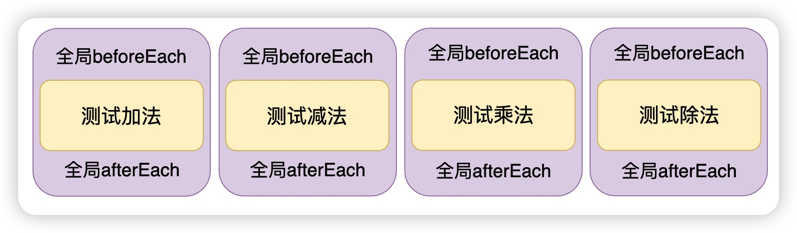

# 重复性的生命周期方法

## 概述

+ 所谓重复性的生命周期方法，就是指这些方法会被添加到每一个测试用例的前后

  + beforeEach 会在执行每个测试用例之前被触发
  + afterEach 会在执行每个测试用例之后被触发

  ```js
  const { sum, sub, mul, div } = require("./tools");

  // beforeEach 会在执行每一个测试用例之前被触发
  beforeEach(()=>{
    console.log("全局的beforeEach");
  });

  afterEach(()=>{
    console.log("全局的afterEach");
  })

  test("测试加法函数", () => {
    const result = sum(1, 3);
    expect(result).toBe(4);
    console.log("\x1b[31m%s\x1b[0m", "测试加法函数");
  });

  test("测试减法函数", () => {
    const result = sub(15, 10);
    expect(result).toBe(5);
    console.log("\x1b[31m%s\x1b[0m", "测试减法函数");
  });

  test("测试乘法函数", () => {
    const result = mul(2, 3);
    expect(result).toBe(6);
    console.log("\x1b[31m%s\x1b[0m", "测试乘法函数");
  });

  test("测试除法函数", () => {
    const result = div(50, 2);
    expect(result).toBe(25);
    console.log("\x1b[31m%s\x1b[0m", "测试除法函数");
  });
  ```

+ 上面的代码为每一个测试用例添加了生命周期方法 `beforeEach` 和 `afterEach` 会在每一个测试用例的前后执行

  

