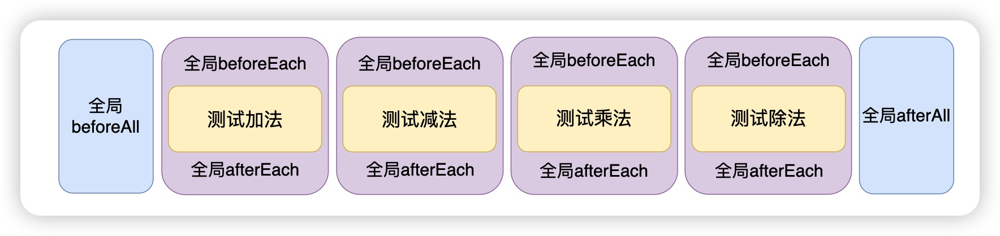

# 一次性的生命周期方法

## 概述

+ 对应的方法是：

  + beforeAll
  + afterAll

+ 顾名思义就是在整个测试开始之前，以及测试用例全部执行完之后执行该生命周期方法

  ```js
  // beforeAll 是在整个测试套件(一个测试文件就是一个测试套件)的第一个测试用例执行之前执行
  beforeAll(()=>{
    console.log("全局的beforeAll");
  })

  // afterAll 会在所有测试用例执行完成之后，然后再执行 afterAll
  afterAll(()=>{
    console.log("全局的afterAll");
  });

  beforeEach(() => {
    console.log("全局的beforeEach");
  });

  afterEach(() => {
    console.log("全局的afterEach");
  });

  test("测试加法函数", () => {
    const result = sum(1, 3);
    expect(result).toBe(4);
    console.log("\x1b[31m%s\x1b[0m", "测试加法函数");
  });

  test("测试减法函数", () => {
    const result = sub(15, 10);
    expect(result).toBe(5);
    console.log("\x1b[31m%s\x1b[0m", "测试减法函数");
  });

  test("测试乘法函数", () => {
    const result = mul(2, 3);
    expect(result).toBe(6);
    console.log("\x1b[31m%s\x1b[0m", "测试乘法函数");
  });

  test("测试除法函数", () => {
    const result = div(50, 2);
    expect(result).toBe(25);
    console.log("\x1b[31m%s\x1b[0m", "测试除法函数");
  });

  ```

  
