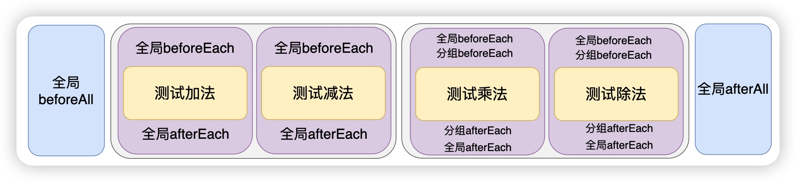
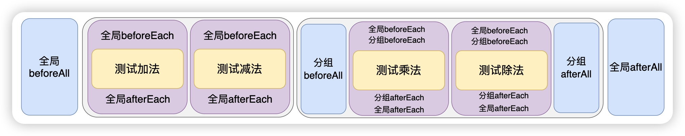

# 分组与生命周期方法

## 概述

+ 如果测试用例比较多，我们可以使用 describe 来进行分组，在一个分组里面也可以书写生命周期方法，但是在分组中的生命周期方法会变为一个局部的生命周期方法，仅对该组测试用例有效，而且这里还涉及到了一个顺序的问题

  ```js
  beforeEach(() => {
    console.log("全局的beforeEach");
  });

  afterEach(() => {
    console.log("全局的afterEach");
  });

  beforeAll(() => {
    console.log("全局的beforeAll");
  });

  // afterAll 会在所有测试用例执行完成之后，然后再执行 afterAll
  afterAll(() => {
    console.log("全局的afterAll");
  });

  test("测试加法函数", () => {
    const result = sum(1, 3);
    expect(result).toBe(4);
    console.log("\x1b[31m%s\x1b[0m", "测试加法函数");
  });

  test("测试减法函数", () => {
    const result = sub(15, 10);
    expect(result).toBe(5);
    console.log("\x1b[31m%s\x1b[0m", "测试减法函数");
  });

  describe("第二组", () => {
    beforeEach(() => {
      console.log("\x1b[34m%s\x1b[0m", "分组beforeEach");
    });
    afterEach(() => {
      console.log("\x1b[34m%s\x1b[0m", "分组afterEach");
    });

    test("测试乘法函数", () => {
      const result = mul(2, 3);
      expect(result).toBe(6);
      console.log("\x1b[31m%s\x1b[0m", "测试乘法函数");
    });

    test("测试除法函数", () => {
      const result = div(50, 2);
      expect(result).toBe(25);
      console.log("\x1b[31m%s\x1b[0m", "测试除法函数");
    });
  });
  ```

+ 如果既有全局的 beforeEach 又有分组内部的 beforeEach，那么是先执行全局的 beforeEach，然后再执行分组内部的 beforeEach，如果是全局 afterEach 以及 分组的 afterEach，那么顺序刚好和 beforeEach 相反

  

+ 同样我们也可以添加分组内部的 beforeAll 和 afterAll，代码如下

  ```js
  beforeEach(() => {
    console.log("全局的beforeEach");
  });

  afterEach(() => {
    console.log("全局的afterEach");
  });

  beforeAll(() => {
    console.log("全局的beforeAll");
  });

  // afterAll 会在所有测试用例执行完成之后，然后再执行 afterAll
  afterAll(() => {
    console.log("全局的afterAll");
  });

  test("测试加法函数", () => {
    const result = sum(1, 3);
    expect(result).toBe(4);
    console.log("\x1b[31m%s\x1b[0m", "测试加法函数");
  });

  test("测试减法函数", () => {
    const result = sub(15, 10);
    expect(result).toBe(5);
    console.log("\x1b[31m%s\x1b[0m", "测试减法函数");
  });

  describe("第二组", () => {
    beforeEach(() => {
      console.log("\x1b[34m%s\x1b[0m", "分组beforeEach");
    });
    afterEach(() => {
      console.log("\x1b[34m%s\x1b[0m", "分组afterEach");
    });

    beforeAll(() => {
      console.log("\x1b[32m%s\x1b[0m", "分组beforeAll");
    });
    afterAll(() => {
      console.log("\x1b[32m%s\x1b[0m", "分组afterAll");
    });

    test("测试乘法函数", () => {
      const result = mul(2, 3);
      expect(result).toBe(6);
      console.log("\x1b[31m%s\x1b[0m", "测试乘法函数");
    });

    test("测试除法函数", () => {
      const result = div(50, 2);
      expect(result).toBe(25);
      console.log("\x1b[31m%s\x1b[0m", "测试除法函数");
    });
  });
  ```

+ beforeAll 是在要执行该分组的测试用例之前会执行，afterAll 是在该分组所有测试用例执行完毕后执行

  
