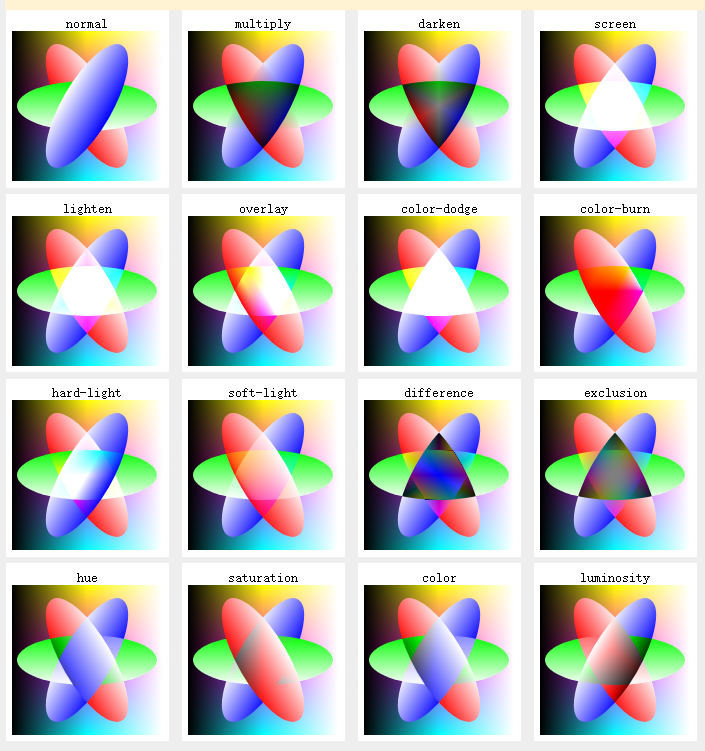
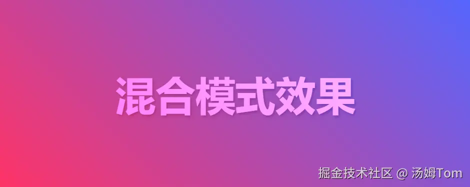
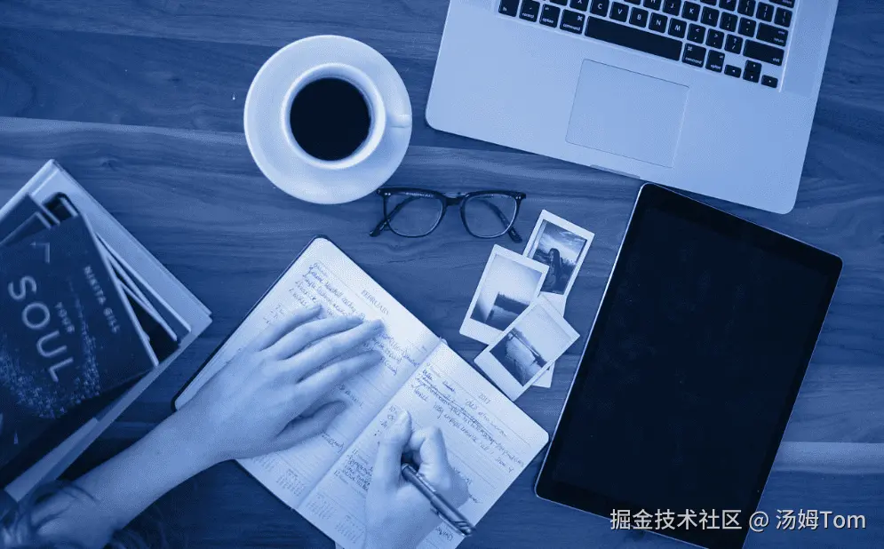

# 色彩的差值混合

## 概述

+ 这个 CSS 属性用来控制‌元素与其下方所有重叠元素‌之间的颜色混合方式，会影响元素全部内容（包括文本、背景和边框），而不是只作用于背景层

+ 参考 https://developer.mozilla.org/zh-CN/docs/Web/CSS/Reference/Properties/mix-blend-mode

## 使用场景

+ 文字与背景图混合，做出文字部分透出背景图的效果。
+ 使用 difference 实现反转色视觉反馈，增强交互元素可见性。
+ 创建类似"剪切蒙版"的视觉效果，让上层元素颜色与下层按特定模式混

## 语法

+ 语法

  ```css
  /* 关键字值 */
  mix-blend-mode: normal; /* 默认值，正常显示不混合 */
  mix-blend-mode: multiply; /* 正片叠底，结果通常更暗 */
  mix-blend-mode: screen; /* 滤色，结果通常更亮，适合模拟光照效果 */
  mix-blend-mode: overlay; /* 叠加，根据底层颜色进行混合 */
  mix-blend-mode: darken; /* 取两个颜色中较暗的那个 */
  mix-blend-mode: lighten; /* 取两个颜色中较亮的那个 */
  mix-blend-mode: color-dodge; /* 通过减小对比度使背景色变亮以反映元素色 */
  mix-blend-mode: color-burn; /* 通过增加对比度使背景色变暗以反映元素色 */
  mix-blend-mode: hard-light; /* 类似 overlay，但根据元素色决定 multiply 或 screen */
  mix-blend-mode: soft-light; /* 类似 hard-light，但更柔和 */
  mix-blend-mode: difference; /* 从较亮的颜色中减去较暗的颜色 */
  mix-blend-mode: exclusion; /* 类似 difference，但对比度更低 */
  mix-blend-mode: hue; /* 使用元素色的色相，结合背景色的饱和度和亮度 */
  mix-blend-mode: saturation; /* 使用元素色的饱和度，结合背景色的色相和亮度 */
  mix-blend-mode: color; /* 使用元素色的色相和饱和度，结合背景色的亮度,类似于照片滤镜,调整叠加层的颜色可以创建各种不同的氛围效果 */
  mix-blend-mode: luminosity; /* 使用元素色的亮度，结合背景色的色相和饱和度 */
  mix-blend-mode: plus-darker; /*  */
  mix-blend-mode: plus-lighter; /*  */

  /* 全局值 */
  mix-blend-mode: inherit;
  mix-blend-mode: initial;
  mix-blend-mode: revert;
  mix-blend-mode: revert-layer;
  mix-blend-mode: unset;
  ```

  

## 属性 difference

+ 原理

  ```
  上一个颜色 - 下一个颜色

    rgh(255,255,255)
  - rgh(0,0,0)
  = rgh(255,255,255)
  ```

## 示例

+ 示例1: 混合模式效果-文字与背景的创意混合

  ```html
  <div class="background">
    <h1 class="blend-text">混合模式效果</h1>
  </div>

  <style>
  .background {
    background: linear-gradient(45deg, #ff3366, #5566ff);
    height: 300px;
    display: flex;
    align-items: center;
    justify-content: center;
  }

  .blend-text {
    color: white;
    font-size: 4rem;
    mix-blend-mode: overlay;
    text-shadow: 2px 2px 4px rgba(0,0,0,0.3);
  }
  </style>
  ```

  

+ 示例2: 图片与背景的颜色混合

  ```html
  <div class="image-container">
    
    <div class="color-overlay"></div>
  </div>

  <style>
  .image-container {
    position: relative;
    width: 500px;
    height: 500px;
  }

  .blend-image {
    width: 100%;
    height: 100%;
    object-fit: cover;
  }

  .color-overlay {
    position: absolute;
    top: 0;
    left: 0;
    width: 100%;
    height: 100%;
    background: #3a7bd5;
    mix-blend-mode: color;
    opacity: 0.7;
  }
  </style>
  ```

  