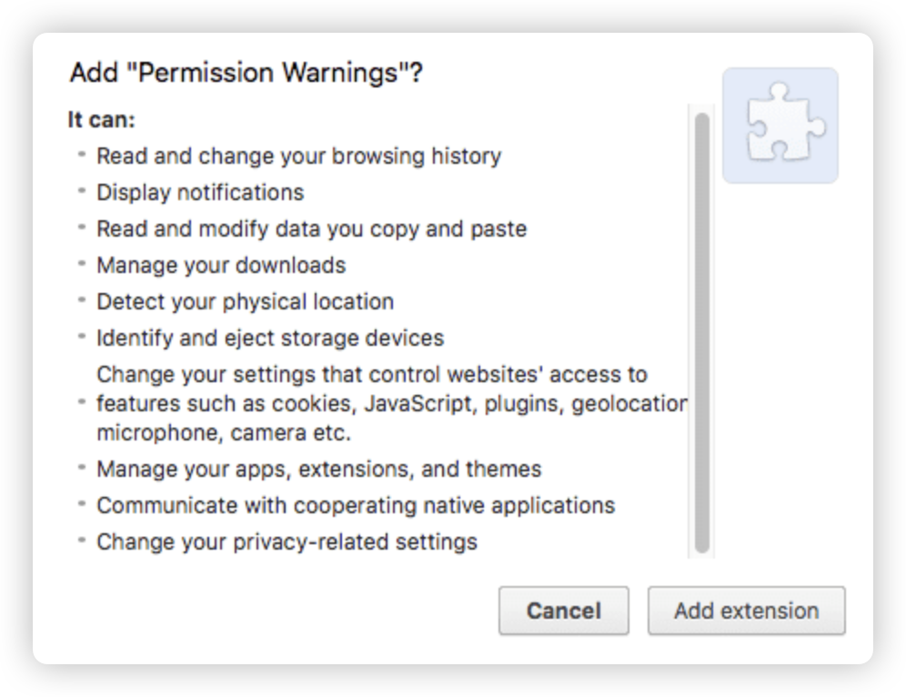

# 权限

## 权限类型

+ 权限类型 `https://developer.chrome.com/docs/extensions/develop/concepts/declare-permissions?hl=zh-cn`

+ 扩展程序可以请求使用相应清单键指定的以下类别的权限：

  + `"permissions"` (`https://developer.chrome.com/docs/extensions/reference/permissions-list?hl=zh-cn`) 包含已知字符串 (`https://developer.chrome.com/docs/extensions/reference/permissions-list?hl=zh-cn`) 列表中的项更改可能会触发警告 `https://developer.chrome.com/docs/extensions/develop/concepts/declare-permissions?hl=zh-cn#warnings`

  + `"optional_permissions"` `https://developer.chrome.com/docs/extensions/reference/api/permissions?hl=zh-cn` 由用户在运行时（而不是安装时）授予

  + `"content_scripts.matches"` (`https://developer.chrome.com/docs/extensions/develop/concepts/content-scripts?hl=zh-cn#static-declarative`) 包含一个或多个匹配模式(https://developer.chrome.com/docs/extensions/develop/concepts/match-patterns?hl=zh-cn)，允许内容脚本注入到一个或多个主机中。更改可能会触发警告 `https://developer.chrome.com/docs/extensions/develop/concepts/declare-permissions?hl=zh-cn#warnings`

  + `"host_permissions"` https://developer.chrome.com/docs/extensions/develop/concepts/declare-permissions?hl=zh-cn#host-permissions 包含一个或多个匹配格式，用于授予对一个或多个主机的访问权限。更改可能会触发警告 https://developer.chrome.com/docs/extensions/develop/concepts/declare-permissions?hl=zh-cn#warnings

  + `"optional_host_permissions"` 由用户在运行时（而不是安装时）授予

+ 如果插件遭到恶意软件入侵，设置权限有助于限制对插件造成的破坏
+ 在安装之前或运行时，系统会向用户显示一些权限警告，以征求用户同意

+ manifest.json 示例

  ```json
  {
    "name": "Permissions Extension",
    ...
    "permissions": [
      "activeTab",
      "contextMenus",
      "storage"
    ],
    "optional_permissions": [
      "topSites",
    ],
    "host_permissions": [
      "https://www.developer.chrome.com/*"
    ],
    "optional_host_permissions":[
      "https://*/*",
      "http://*/*"
    ],
    "content_scripts": [
      {
        "matches": ["<all_urls>"],
        "js": ["content.js"]
      }
    ],
    ...
    "manifest_version": 3
  }
  ```

## 主机权限

+ 主机权限允许扩展程序与网址的匹配格式互动
+ 有些 Chrome API 除了拥有自己的 API 权限外，还需要主机权限

+ 需要主机权限的 API：

  + 从扩展程序 Service Worker 和扩展程序页面发出 fetch() 请求 `https://developer.mozilla.org/docs/Web/API/Fetch_API/Using_Fetch`
  + 使用 chrome.tabsAPI 读取 `https://developer.chrome.com/docs/extensions/reference/api/tabs?hl=zh-cn` 和查询敏感的标签页属性（网址、标题和 favIconUrl）  `https://developer.chrome.com/docs/extensions/reference/api/tabs?hl=zh-cn#type-Tab`
  + 以编程方式注入内容脚本 `https://developer.chrome.com/docs/extensions/develop/concepts/content-scripts?hl=zh-cn#programmatic`
  + 使用 chrome.webRequest API 监控和控制网络请求 `https://developer.chrome.com/docs/extensions/reference/api/webRequest?hl=zh-cn`
  + 通过 chrome.cookies API 访问 Cookie `https://developer.chrome.com/docs/extensions/reference/api/cookies?hl=zh-cn`
  + 使用 chrome.declarativeNetRequest API 重定向和修改请求及响应标头 `https://developer.chrome.com/docs/extensions/reference/api/declarativeNetRequest?hl=zh-cn`

## 包含警告的权限

+ 如果插件请求多项权限，并且其中的许多权限会在安装时显示警告，用户会看到警告列表：

+ 如果插件只显示少量警告或向用户说明权限，用户更有可能信任该插件。请考虑实现可选权限或功能略弱的 API，以避免收到警告
+ 在 host_permissions 和 content_scripts.matches 字段中添加或更改匹配模式也会触发警告

  

## 权限警告列表

| 权限                                                                | 说明                                                                                        | 警告                                                                                              |
| :------------------------------------------------------------------ | :------------------------------------------------------------------------------------------ | :------------------------------------------------------------------------------------------------ |
| `http://*/*` <br />`https://*/*`<br /> `*://*/*` <br />`<all_urls>` | 对所有主机的访问权限                                                                        | 读取和更改在所有网站上的所有数据                                                                  |
| `https://HostName.com/`                                             | 对 `https://HostName.com/` 的访问权限                                                       | 读取和更改在 `HostName.com` 上的数据                                                              |
| `accessibilityFeatures.modify`                                      | 允许此插件修改个别无障碍功能的状态                                                          | 更改无障碍设置                                                                                    |
| `accessibilityFeatures.read`                                        | 允许此插件读取各个无障碍功能状态                                                            | 查看无障碍设置                                                                                    |
| `bookmarks`                                                         | 对 `chrome.bookmarks API` 的访问权限                                                        | 读取和更改书签                                                                                    |
| `clipboardRead`                                                     | 如果插件使用 `document.execCommand('paste')`，则必须提供                                    | 读取复制和粘贴的数据                                                                              |
| `clipboardWrite`                                                    | 表示该插件使用 `document.execCommand('copy')` 或 `document.execCommand('cut')`              | 修改复制和粘贴的数据                                                                              |
| `contentSettings`                                                   | 对 `chrome.contentSettings API` 的访问权限                                                  | 更改用于控制网站对 `Cookie`、`JavaScript`、插件、地理定位、麦克风、摄像头等功能的使用权限的设置。 |
| `debugger`                                                          | 对 `chrome.debugger API` 的访问权限                                                         | 访问页面调试程序后端  读取和更改在所有网站上的所有数据                                            |
| `declarativeNetRequest`                                             | 对 `chrome.declarativeNetRequest API` 的访问权限                                            | 屏蔽任何网页上的内容                                                                              |
| `declarativeNetRequestFeedback`                                     | 函数和事件的访问权限，这些函数和事件会返回匹配的声明式规则的相关信息                        | 读取浏览记录                                                                                      |
| `desktopCapture`                                                    | 对 `chrome.desktopCapture API` 的访问权限                                                   | 截取屏幕上的内容                                                                                  |
| `downloads`                                                         | 对 `chrome.downloads API` 的访问权限                                                        | 管理下载内容                                                                                      |
| `favicon`                                                           | 对 `Favicon API` 的访问权限                                                                 | 读取访问的网站的图标                                                                              |
| `geolocation`                                                       | 允许插件在不提示用户授予权限的情况下使用 `HTML5 geolocation API`                            | 检测实际位置                                                                                      |
| `history`                                                           | 对 `chrome.history API` 的访问权限                                                          | 读取和更改所有已登录设备上的浏览记录                                                              |
| `identity.email`                                                    | 通过 `chrome.identity API` 对电子邮件地址的访问权限                                         | 获取电子邮件地址                                                                                  |
| `management`                                                        | 对 `chrome.management API` 的访问权限                                                       | 管理应用、插件和主题背景                                                                          |
| `nativeMessaging`                                                   | 对 `Native Messaging API` 的访问权限                                                        | 与协作的原生应用通信                                                                              |
| `notifications`                                                     | 对 `chrome.notifications API` 的访问权限                                                    | 显示通知                                                                                          |
| `pageCapture`                                                       | 对 `chrome.pageCapture API` 的访问权限                                                      | 读取和更改在所有网站上的所有数据                                                                  |
| `privacy`                                                           | 对 `chrome.privacy API` 的访问权限                                                          | 更改与隐私相关的设置                                                                              |
| `proxy`                                                             | 对 `chrome.proxy API` 的访问权限                                                            | 读取和更改在所有网站上的所有数据                                                                  |
| `readingList`                                                       | 对 `chrome.readingList API` 的访问权限                                                      | 读取和更改阅读清单中的条目                                                                        |
| `sessions` 和 `history`                                             | 对 `chrome.sessionsAPI` 和 `chrome.history API` 的访问权限                                  | 读取和更改所有已登录设备上的浏览记录                                                              |
| `sessions` 和 `tabs`                                                | 对 `chrome.sessions API` 以及 `Tab` 对象的特权字段的访问权限                                | 读取在所有已登录账号设备上的浏览记录                                                              |
| `system.storage`                                                    | 对 `chrome.system.storage API `的访问权限                                                   | 识别和弹出存储设备                                                                                |
| `tabCapture`                                                        | 对 `chrome.tabCapture API` 的访问权限                                                       | 读取和更改在所有网站上的所有数据                                                                  |
| `tabGroups`                                                         | 对 `chrome.tabGroups API` 的访问权限                                                        | 查看和管理标签页分组                                                                              |
| `tabs`                                                              | 对多个 `API`（包括 `chrome.tabs` 和 `chrome.windows`）使用的 `Tab` 对象的特权字段的访问权限 | 读取浏览记录                                                                                      |
| `topSites`                                                          | 对 `chrome.topSites API` 的访问权限                                                         | 读取最常访问的网站列表                                                                            |
| `ttsEngine`                                                         | 对 `chrome.ttsEngine API` 的访问权限                                                        | 朗读使用合成语音说出的所有文字                                                                    |
| `webAuthenticationProxy`                                            | 对 `chrome.webAuthenticationProxy API` 的访问权限                                           | 读取和更改在所有网站上的所有数据                                                                  |
| `webNavigation`                                                     | 对 `chrome.webNavigation API` 的访问权限                                                    | 读取浏览记录                                                                                      |

## 权限列表

+ 权限列表 https://developer.chrome.com/docs/extensions/reference/permissions-list?hl=zh-cn
