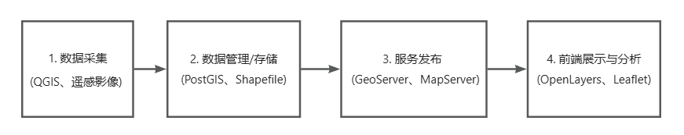
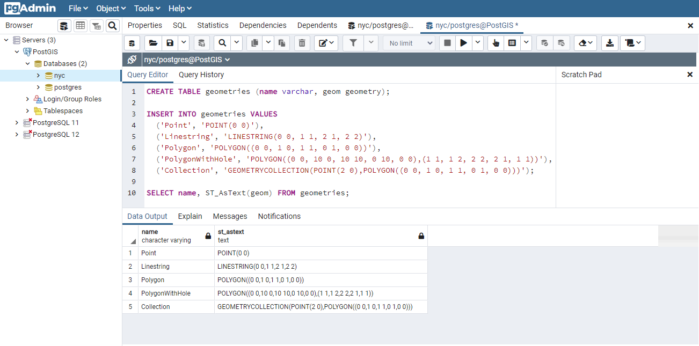
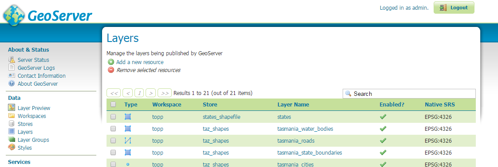
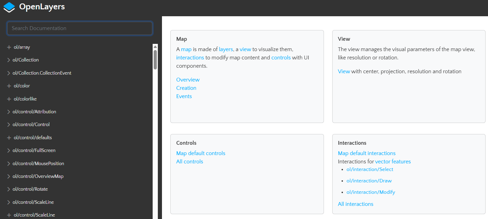

# GIS全栈

## 全栈流程

+ GIS全栈指的是掌握并能独立开发从 **数据采集 → 存储管理 → 服务发布 → 前端展示与分析** 全流程的开发技能，类似于 Web 中的“前端 + 后端 + 数据库”的全栈概念

  

## 步骤1 数据采集

+ [QGIS](https://qgis.org/)等软件： 对原始数据进行清洗和处理， 对矢量要素进行属性修正、合并或裁剪，进行投影转换、坐标纠错，以及提取分析感兴趣区域等

  + 空间数据编辑（矢量图层、属性表）
  + 数据格式转换（Shapefile、GeoJSON、PostGIS 等）
  + 可视化制图（样式、图层叠加）

  

## 步骤2 数据管理/存储

+ [PostGIS](https://postgis.net/)：地理空间数据库（基于 PostgreSQL）

  + 用来存储地理数据（点、线、面、栅格等）
  + 支持复杂的空间查询（如距离、相交、缓冲等）
  + 可以作为 GeoServer 的数据源
  + QGIS 可以连接 PostGIS 进行编辑

  

## 步骤3 服务发布

+ [GeoServer](https://geoserver.org/)：地图服务中间件，需要Java环境

  + 用于将 PostGIS 或文件（Shapefile、GeoTIFF 等）发布为地图服务（如 WMS/WFS/WCS/WMTS）
  + 提供标准的 OGC 接口，供前端或其他系统调用
  + 可以定义图层样式（SLD）、图层组合、权限控制等
  + 是连接数据库和前端展示的重要“中转站”

  

## 步骤4 前端展示与分析

+ [OpenLayers](https://openlayers.org/)、LeafLet、MapBox、Cesium（三维）都属于前端地理开发框架

  + 是运行在浏览器上的 JavaScript 地图框架
  + 通过 WMS/WFS 调用 GeoServer 服务
  + 实现地图的显示、图层控制、空间查询、测量等交互功能
  + 支持与地图服务及地理数据的高度集成

  
