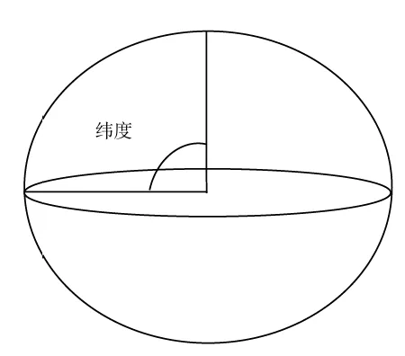
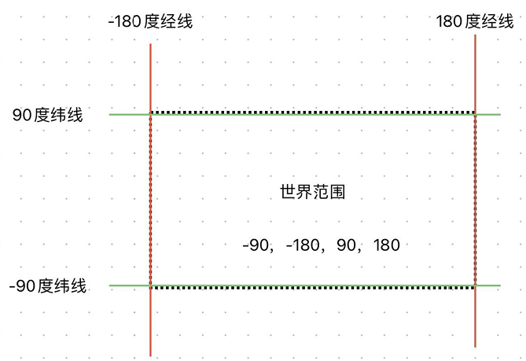

# 经纬度

## 地理坐标系

+ 地理坐标系一般是指由经度、纬度和相对高度组成的坐标系，能够标示地球上的任何一个位置
+ 经度和纬度常合称为经纬度，即经度（Longitude）和纬度（Latitude）

## 经纬度范围

+ 坐标系的X轴表示经度，范围：-180° ~ 180°

+ 坐标系的Y轴表示纬度，范围：-90° ~ 90°

+ 经度已英国本初子午线作为0°，向西为西经 0° ~ -180°，向东为东经 0° ~ 180°

+ 纬度的定义是地球重力方向的铅垂线和赤道平面的夹角

  
  

  ```javascript
  // 杭州经纬度
  const coordinate = [120.153576, 30.287459]
  ```
