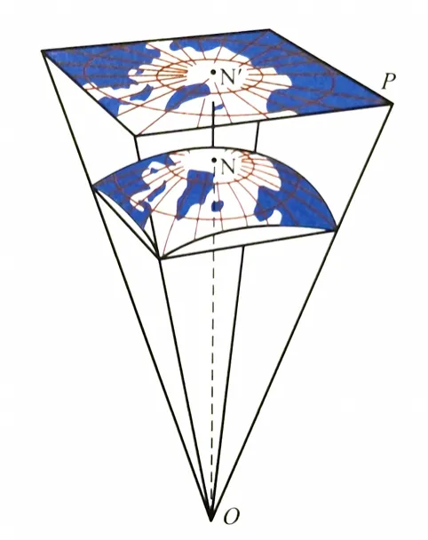
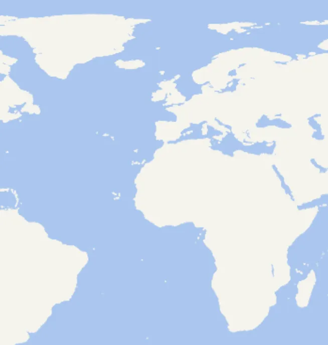
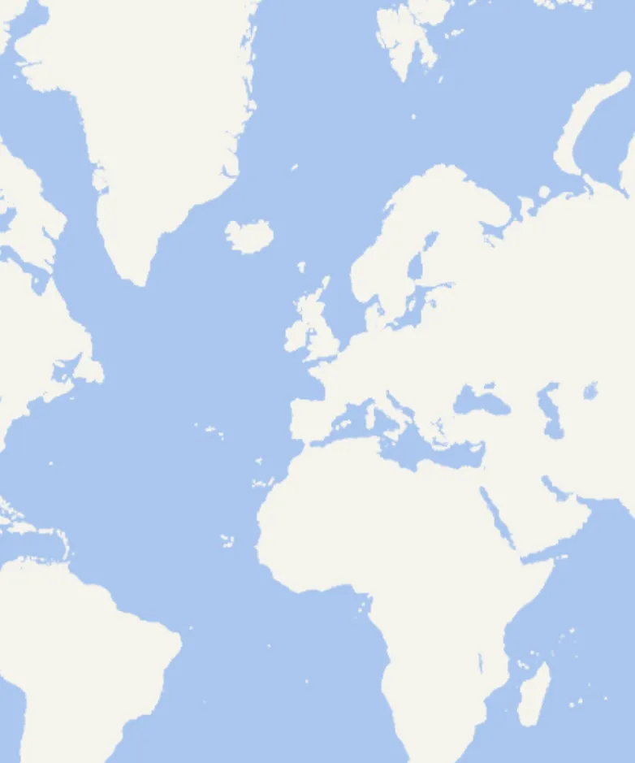

# 地图投影

## 投影坐标系

+ 在地理学中，坐标系分为地理坐标系和投影坐标系

## 地理坐标系

+ WGS 84 全球 GPS 标准坐标系，单位：经纬度
+ CGCS2000 中国官方地理坐标系，单位：经纬度，跟WGS 84差不多等价
+ GCJ-02 中国火星坐标系，经过偏移处理
+ BD-09 百度坐标系，GCJ-02 二次加密

  ```javascript
  const wgs84 = [116.397, 39.908]
  const gcj02 = [116.403, 39.915]
  const bd09 = [116.410, 39.920]
  ```

## 投影坐标系

+ 基于地理坐标系进行的一些投影变换，单位：米、千米
+ 比较出名的有，Web墨卡托投影（Mercator）

  ```javascript
  // 杭州墨卡托坐标
  const coordinate = [13375434.897310896, 3540553.792264361]

  function lonLatToMercator(lon, lat) {
    const R = 6378137.0;
    const x = R * lon * Math.PI / 180;
    const y = R * Math.log(Math.tan(Math.PI / 4 + (lat * Math.PI / 180) / 2));
    return [x, y];
  }
  ```

## 墨卡托投影

+ 将地球的球面坐标（经纬度）转换为平面坐标（X,Y），以便在地图上进行绘制
+ 特点：会保持角度，但是不保持面积，适合航海导航

  
  
  

+ 做二维的WebGIS开发，墨卡托投影非常的重要！
