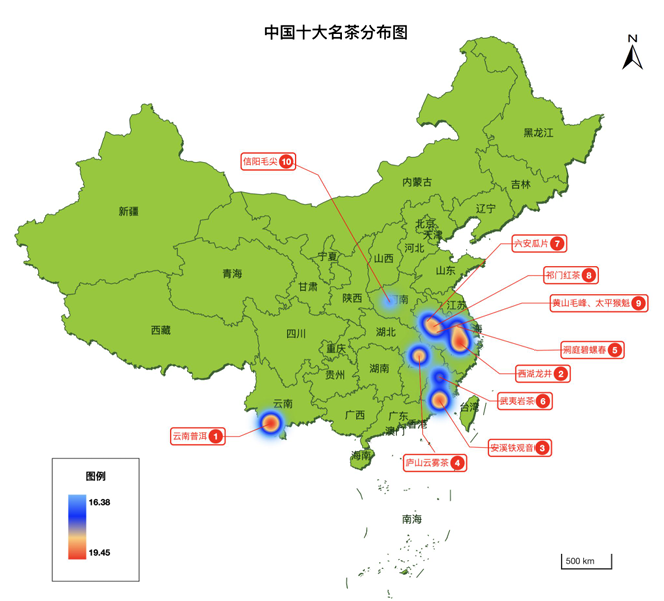

#  地图组成

## 地图核心要素

+ 地图核心要素是指一幅地图中最基本、最关键的组成部分，用来传达地理信息，使读图者能够准确理解地图内容

  | **核心要素**      | **说明**                                                                         |
  | ----------------- | -------------------------------------------------------------------------------- |
  | 图名              | 说明地图的主题、内容或区域。例如《北京市交通图》、《中国气候分布图》。           |
  | 图例（图示）      | 说明地图中各种符号、颜色、线型所代表的实际意义，是读懂地图的关键工具。           |
  | 比例尺            | 表示地图上距离与实际地面距离的比例。可以是数值比例尺（如1:100000）或线段比例尺。 |
  | 方向指示          | 通常通过“指北针”或“经纬网”表示地图的方向，大多数地图默认上北下南。               |
  | 坐标系统 / 经纬网 | 显示地理位置的参考系统，用于定位，常见为经纬线、投影坐标等。                     |
  | 制图时间          | 显示地图绘制的时间，有助于判断地图数据的时效性。                                 |
  | 数据来源          | 表示地图所用数据的来源或采集单位，增强地图的权威性与可信度。                     |
  | 图廓/图框         | 地图边界，包含地图的空间范围以及边缘注记。                                       |
  | 制图单位          | 地图制作单位、制图者、版权等信息，通常在地图边角处标注。                         |


  

## 地图结构

  ```shell
  地图
  ├── 底图（BaseMap）
  │   └── 通常为不可交互的背景图层（OSM、天地图等）
  ├── 主题图层（Layers）
  │   ├── 按主题分层组织的空间数据，如道路图层、水系图层、建筑图层，位于底图之上。
  │   ├── 数据源（Data Source）
  │      	├── 数据格式（GeoJSON、WMS、WMTS、PostGIS等）
  │      	├── 空间投影 / 坐标系信息
  │       └── 要素（Features）
  │       		├── 几何信息（点/线/面）
  │       		└── 属性信息（名称、类型、数值等）
  └── 地图要素（图例、比例尺、指北针等）
  ```

  ```javascript
  const coordinate = [13382829, 3537014]
  const vectorLayer = new VectorLayer({
    source: new VectorSource({
      features: [
        new Feature({
          geometry: new Point(coordinate),
        })
      ],
    }),
  })
  const map = new Map({
    target: 'map',
    layers: [
      new TileLayer({
        source: new OSM()
      }),
      vectorLayer
    ],
    controls: [
      new ScaleLine(),
      new OverviewMap(),
    ],
    view: new View({
      center: coordinate,
      zoom: 5,
    })
  })
  ```
