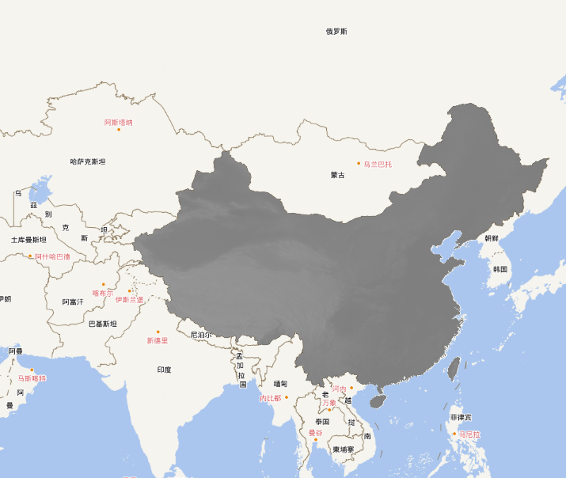
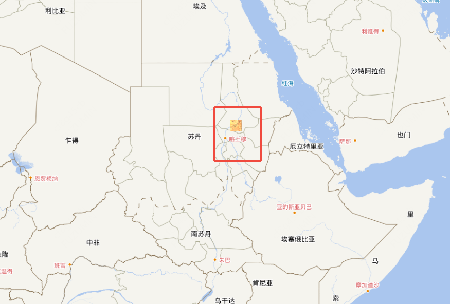

# GeoTIFF数据

## 概述

+ 栅格数据（raster data）也叫遥感影像数据， 来源包括卫星、航天飞机、无人机等
+ GeoTIFF格式为 `.tif`文件，该格式支持嵌入经纬度坐标信息，可直接加载到地图中

  ```javascript
  import { WebGLTile as WebGLTileLayer } from 'ol/layer/WebGLTile.js'
  import { GeoTIFF } from 'ol/source'
  import china from './assets/china.tif?url'

  new WebGLTileLayer({
    source: new GeoTIFF({
      sources: [
        {
          url: china,
        },
      ],
    })
  })
  ```

+ 也支持在线地址：

  ```text
  https://sentinel-cogs.s3.us-west-2.amazonaws.com/sentinel-s2-l2a-cogs/36/Q/WD/2020/7/S2A_36QWD_20200701_0_L2A/TCI.tif
  ```

  ```js
  new WebGLTileLayer({
    source: new GeoTIFF({
      sources: [
        {
          url: "https://sentinel-cogs.s3.us-west-2.amazonaws.com/sentinel-s2-l2a-cogs/36/Q/WD/2020/7/S2A_36QWD_20200701_0_L2A/TCI.tif",
        },
      ],
    })
  })
  ```

## 示例

+ 使用本地数据 tif

  ```html
  <script setup lang="ts">
  import { Map, View } from "ol";
  import { Tile as TileLayer } from "ol/layer";
  import { XYZ } from "ol/source";
  import WebGLTileLayer from "ol/layer/WebGLTile";
  import { GeoTIFF } from "ol/source";
  import china from "./assets/china.tif?url";

  const mapRef = useTemplateRef<InstanceType<typeof HTMLElement>>("mapRef");

  onMounted(() => {
    new Map({
      target: mapRef.value!,
      layers: [
        new TileLayer({
          source: new XYZ({
            url:
              "http://t0.tianditu.gov.cn/vec_w/wmts?SERVICE=WMTS&REQUEST=GetTile&VERSION=1.0.0&LAYER=vec&STYLE=default&TILEMATRIXSET=w&FORMAT=tiles&TILEMATRIX={z}&TILEROW={y}&TILECOL={x}&tk=" +
              import.meta.env.VITE_API_TIANDITU_MAP,
          }),
        }),
        new TileLayer({
          source: new XYZ({
            url:
              "http://t0.tianditu.gov.cn/cva_w/wmts?SERVICE=WMTS&REQUEST=GetTile&VERSION=1.0.0&LAYER=cva&STYLE=default&TILEMATRIXSET=w&FORMAT=tiles&TILEMATRIX={z}&TILEROW={y}&TILECOL={x}&tk=" +
              import.meta.env.VITE_API_TIANDITU_MAP,
          }),
        }),
        new WebGLTileLayer({
          source: new GeoTIFF({
            sources: [
              {
                url: china,
              },
            ],
          }),
        }),
      ],
      view: new View({
        center: [0, 0],
        // center: coordinate,
        zoom: 4,
      }),
    });
  });
  </script>

  <template>
    <div ref="mapRef" class="map"></div>
  </template>

  <style>
  @import "node_modules/ol/ol.css";
  </style>
  <style scoped>
  .map {
    width: 100%;
    height: 100vh;
  }
  </style>
  ```

  

+ 使用在线

  ```js
  <script setup lang="ts">
  import { Map, View } from "ol";
  import { Tile as TileLayer } from "ol/layer";
  import { XYZ } from "ol/source";
  import WebGLTileLayer from "ol/layer/WebGLTile";
  import { GeoTIFF } from "ol/source";
  import china from "./assets/china.tif?url";

  const mapRef = useTemplateRef<InstanceType<typeof HTMLElement>>("mapRef");

  onMounted(() => {
    new Map({
      target: mapRef.value!,
      layers: [
        new TileLayer({
          source: new XYZ({
            url:
              "http://t0.tianditu.gov.cn/vec_w/wmts?SERVICE=WMTS&REQUEST=GetTile&VERSION=1.0.0&LAYER=vec&STYLE=default&TILEMATRIXSET=w&FORMAT=tiles&TILEMATRIX={z}&TILEROW={y}&TILECOL={x}&tk=" +
              import.meta.env.VITE_API_TIANDITU_MAP,
          }),
        }),
        new TileLayer({
          source: new XYZ({
            url:
              "http://t0.tianditu.gov.cn/cva_w/wmts?SERVICE=WMTS&REQUEST=GetTile&VERSION=1.0.0&LAYER=cva&STYLE=default&TILEMATRIXSET=w&FORMAT=tiles&TILEMATRIX={z}&TILEROW={y}&TILECOL={x}&tk=" +
              import.meta.env.VITE_API_TIANDITU_MAP,
          }),
        }),
        new WebGLTileLayer({
          source: new GeoTIFF({
            sources: [
              {
                // url: china,
                url: "https://sentinel-cogs.s3.us-west-2.amazonaws.com/sentinel-s2-l2a-cogs/36/Q/WD/2020/7/S2A_36QWD_20200701_0_L2A/TCI.tif",
              },
            ],
          }),
        }),
      ],
      view: new View({
        center: [0, 0],
        // center: coordinate,
        zoom: 4,
      }),
    });
  });
  </script>

  <template>
    <div ref="mapRef" class="map"></div>
  </template>

  <style>
  @import "node_modules/ol/ol.css";
  </style>
  <style scoped>
  .map {
    width: 100%;
    height: 100vh;
  }
  </style>
  ```

  
