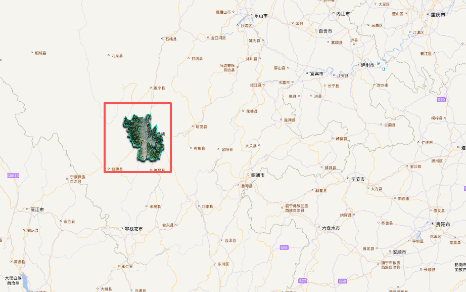

# ImageStatic数据

## 概述

+ 图像格式如 `.png`、`.jpg` 等**不包含地理坐标信息**，需手动在代码中补充信息后才能用于地图展示

  ```javascript
  import { Image as ImageLayer } from 'ol/layer'
  import { ImageStatic } from 'ol/source'
  import xc from './assets/xc.png'

  const extent = transformExtent([101.7, 27.5, 102.4, 28.2], 'EPSG:4326', 'EPSG:3857')
  const map = new Map({
    target: 'map',
    layers: [
      new ImageLayer({
        source: new ImageStatic({
          url: xc,
          imageExtent: extent,
        }),
      }),
    ],
    view: new View()
  });

  // 让指定的 extent 范围自适应 map 容器
  map.getView().fit(extent)
  ```

  

+ 让指定的 extent 范围自适应 map 容器

  ```js
  // 让指定的 extent 范围自适应 map 容器
  map.getView().fit(extent)
  ```

  

## 示例

+ 示例

  ```html
  <script setup lang="ts">
  import { Map, View } from "ol";
  import { Tile as TileLayer } from "ol/layer";
  import { XYZ } from "ol/source";
  import { Image as ImageLayer } from "ol/layer";
  import { ImageStatic } from "ol/source";
  import xc from "./assets/xc.png";
  import { transformExtent } from "ol/proj";

  const mapRef = useTemplateRef<InstanceType<typeof HTMLElement>>("mapRef");

  const extent = transformExtent([101.7, 27.5, 102.4, 28.2], "EPSG:4326", "EPSG:3857");

  onMounted(() => {
    const map = new Map({
      target: mapRef.value!,
      layers: [
        new TileLayer({
          source: new XYZ({
            url:
              "http://t0.tianditu.gov.cn/vec_w/wmts?SERVICE=WMTS&REQUEST=GetTile&VERSION=1.0.0&LAYER=vec&STYLE=default&TILEMATRIXSET=w&FORMAT=tiles&TILEMATRIX={z}&TILEROW={y}&TILECOL={x}&tk=" +
              import.meta.env.VITE_API_TIANDITU_MAP,
          }),
        }),
        new TileLayer({
          source: new XYZ({
            url:
              "http://t0.tianditu.gov.cn/cva_w/wmts?SERVICE=WMTS&REQUEST=GetTile&VERSION=1.0.0&LAYER=cva&STYLE=default&TILEMATRIXSET=w&FORMAT=tiles&TILEMATRIX={z}&TILEROW={y}&TILECOL={x}&tk=" +
              import.meta.env.VITE_API_TIANDITU_MAP,
          }),
        }),
        new ImageLayer({
          source: new ImageStatic({
            url: xc,

            // 手动设置坐标信息
            imageExtent: extent,
          }),
        }),
      ],
      view: new View({
        center: [0, 0],
        // center: coordinate,
        zoom: 4,
      }),
    });

    // 让指定的 extent 范围自适应 map 容器
    map.getView().fit(extent)
  });
  </script>

  <template>
    <div ref="mapRef" class="map"></div>
  </template>

  <style>
  @import "node_modules/ol/ol.css";
  </style>
  <style scoped>
  .map {
    width: 100%;
    height: 100vh;
  }
  </style>
  ```
