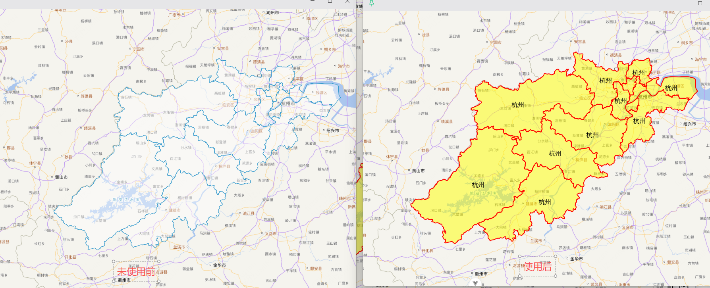

# 矢量图层样式

## 概述

+ OpenLayers框架可以通过style组件给矢量数据添加样式

  ```javascript
  import { Style, Fill, Stroke, Text } from 'ol/style'

  const vectorLayer = new VectorLayer({
    source: vectorSource,
    style: new Style({
      // 描边
      stroke: new Stroke({
        color: '#FF0000',
        width: 2,
      }),

      // 填充
      fill: new Fill({
        // color: 'rgb(255, 255, 0, 0.5)',
        color: '#FFFF0080'
      }),

      // 文本
      text: new Text({
        font: '16px sans-serif',
        fill: new Fill({
          color: 'black',
        }),
        text: '杭州',
      }),
    }),
  })
  ```

  

## 实例

+ 示例

  ```js
  <script setup lang="ts">
  import { Map, View } from "ol";
  import { XYZ, Vector } from "ol/source";
  import { Tile as TileLayer, Vector as VectorLayer } from "ol/layer";
  import { GeoJSON } from "ol/format";
  import hangzhou from "./assets/hangzhou.json?url";
  import { Style, Fill, Stroke, Text } from "ol/style";

  const mapRef = useTemplateRef<InstanceType<typeof HTMLElement>>("mapRef");

  const vectorSource = new Vector({
    url: hangzhou,
    // url: "https://geo.datav.aliyun.com/areas_v3/bound/geojson?code=330600_full",
    format: new GeoJSON({
      dataProjection: "EPSG:4326", // 数据源是经纬度
      featureProjection: "EPSG:3857", // 地图是墨卡托
    }),
  });

  const vectorLayer = new VectorLayer({
    source: vectorSource,
    style: new Style({
      stroke: new Stroke({
        color: "#FF0000",
        width: 2,
      }),
      fill: new Fill({
        // color: 'rgb(255, 255, 0, 0.5)',
        color: "#FFFF0080",
      }),
      text: new Text({
        font: "16px sans-serif",
        fill: new Fill({
          color: "black",
        }),
        text: "杭州",
      }),
    }),
  });

  onMounted(() => {
    const map = new Map({
      target: mapRef.value!,
      layers: [
        new TileLayer({
          source: new XYZ({
            url:
              "http://t0.tianditu.gov.cn/vec_w/wmts?SERVICE=WMTS&REQUEST=GetTile&VERSION=1.0.0&LAYER=vec&STYLE=default&TILEMATRIXSET=w&FORMAT=tiles&TILEMATRIX={z}&TILEROW={y}&TILECOL={x}&tk=" +
              import.meta.env.VITE_API_TIANDITU_MAP,
          }),
        }),
        new TileLayer({
          source: new XYZ({
            url:
              "http://t0.tianditu.gov.cn/cva_w/wmts?SERVICE=WMTS&REQUEST=GetTile&VERSION=1.0.0&LAYER=cva&STYLE=default&TILEMATRIXSET=w&FORMAT=tiles&TILEMATRIX={z}&TILEROW={y}&TILECOL={x}&tk=" +
              import.meta.env.VITE_API_TIANDITU_MAP,
          }),
        }),
        vectorLayer,
      ],
      view: new View({
        center: [0, 0],
        // center: coordinate,
        zoom: 4,
      }),
    });

    vectorSource.on("change", () => {
      if (vectorSource.getState() === "ready") {
        const extent = vectorSource.getExtent()!;
        map.getView().fit(extent);
      }
    });
  });
  </script>

  <template>
    <div ref="mapRef" class="map"></div>
  </template>

  <style>
  @import "node_modules/ol/ol.css";
  </style>
  <style scoped>
  .map {
    width: 100%;
    height: 100vh;
  }
  </style>

  ```
