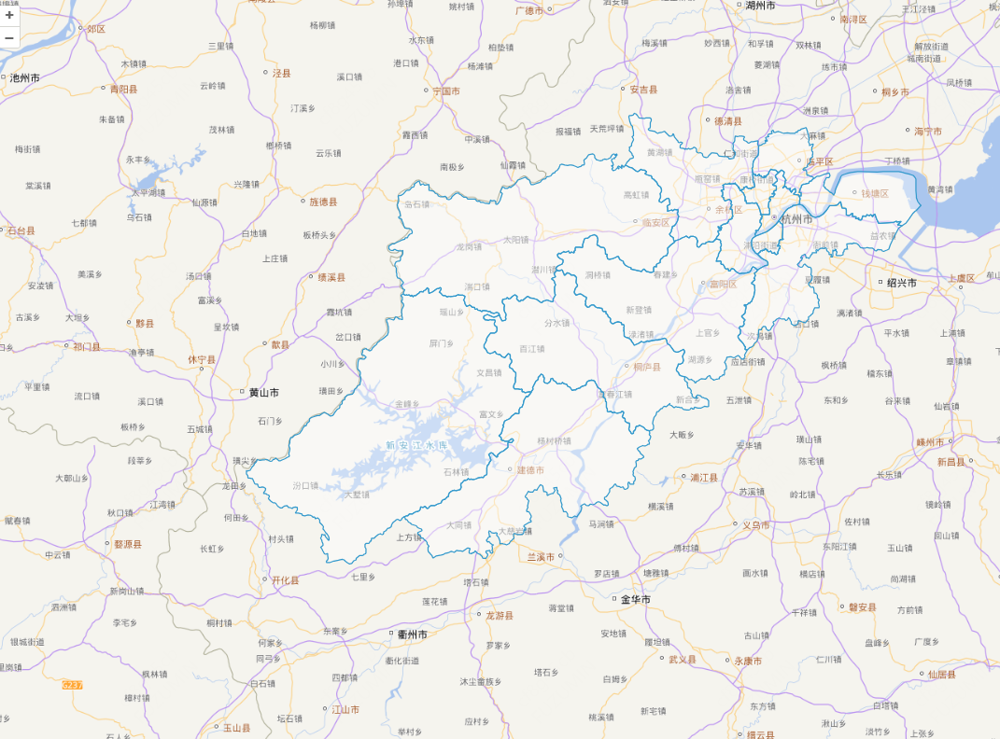

# GeoJSON数据

## 概述

+ 矢量数据（vector data）用于描述地理对象的形状、位置和属性
+ GeoJSON属于常见的矢量数据，基于 JSON 的轻量地理格式，广泛用于 WebGIS

  ```javascript
  import { Vector as VectorLayer } from 'ol/layer'
  import { Vector } from 'ol/source'
  import { GeoJSON } from 'ol/format'
  import hangzhou from './assets/hangzhou.json'

  const vectorSource = new Vector({
    features: new GeoJSON().readFeatures(hangzhou, {
      dataProjection: 'EPSG:4326',         // 数据源是经纬度
      featureProjection: 'EPSG:3857',      // 地图是墨卡托
    })
  })
  const vectorLayer = new VectorLayer({
    source: vectorSource,
  })

  const extent = vectorSource.getExtent()
  map.getView().fit(extent)
  ```

## 示例

+ 示例

  ```html
  <script setup lang="ts">
  import { Map, View } from "ol";
  import { XYZ, Vector } from "ol/source";
  import { Tile as TileLayer, Vector as VectorLayer } from "ol/layer";
  import { GeoJSON } from "ol/format";
  import hangzhou from "./assets/hangzhou.json";

  const mapRef = useTemplateRef<InstanceType<typeof HTMLElement>>("mapRef");

  const vectorSource = new Vector({
    // url: hangzhou,
    // url: "https://geo.datav.aliyun.com/areas_v3/bound/geojson?code=330600_full",
    features: new GeoJSON().readFeatures(hangzhou, {
      dataProjection: "EPSG:4326", // 数据源是经纬度
      featureProjection: "EPSG:3857", // 地图是墨卡托
    }),
  });

  const vectorLayer = new VectorLayer({
    source: vectorSource,
  });

  onMounted(() => {
    const map = new Map({
      target: mapRef.value!,
      layers: [
        new TileLayer({
          source: new XYZ({
            url:
              "http://t0.tianditu.gov.cn/vec_w/wmts?SERVICE=WMTS&REQUEST=GetTile&VERSION=1.0.0&LAYER=vec&STYLE=default&TILEMATRIXSET=w&FORMAT=tiles&TILEMATRIX={z}&TILEROW={y}&TILECOL={x}&tk=" +
              import.meta.env.VITE_API_TIANDITU_MAP,
          }),
        }),
        new TileLayer({
          source: new XYZ({
            url:
              "http://t0.tianditu.gov.cn/cva_w/wmts?SERVICE=WMTS&REQUEST=GetTile&VERSION=1.0.0&LAYER=cva&STYLE=default&TILEMATRIXSET=w&FORMAT=tiles&TILEMATRIX={z}&TILEROW={y}&TILECOL={x}&tk=" +
              import.meta.env.VITE_API_TIANDITU_MAP,
          }),
        }),
        vectorLayer,
      ],
      view: new View({
        center: [0, 0],
        // center: coordinate,
        zoom: 4,
      }),
    });

    const extent = vectorSource.getExtent()!;
    map.getView().fit(extent);
  });
  </script>

  <template>
    <div ref="mapRef" class="map"></div>
  </template>

  <style>
  @import "node_modules/ol/ol.css";
  </style>
  <style scoped>
  .map {
    width: 100%;
    height: 100vh;
  }
  </style>
  ```

  
