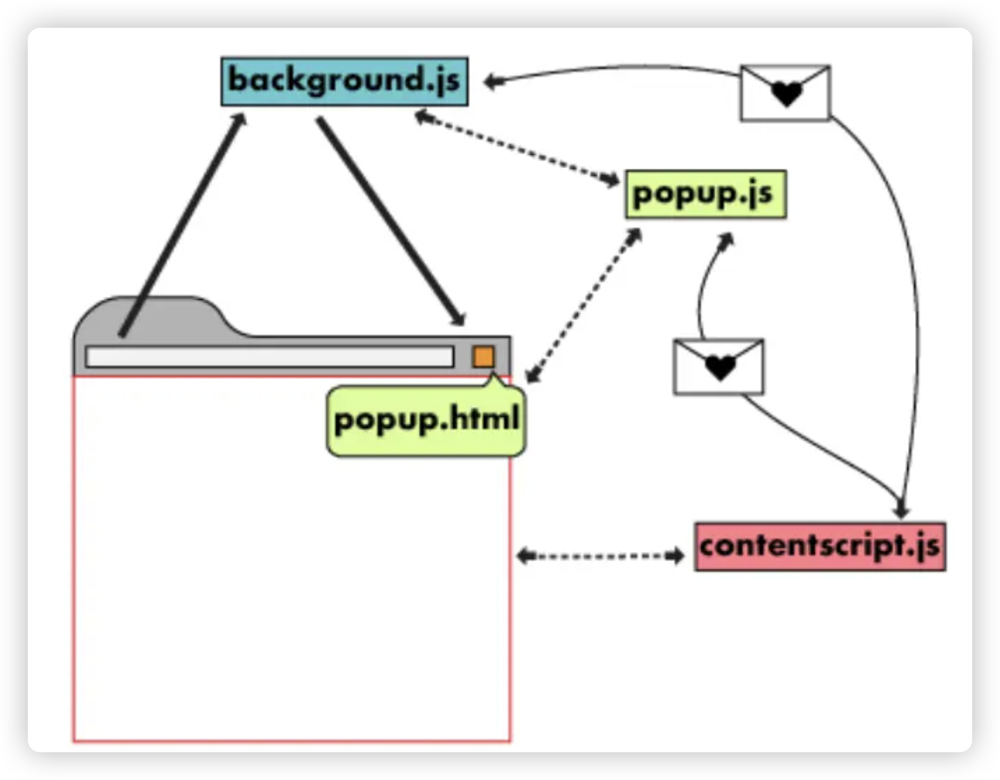
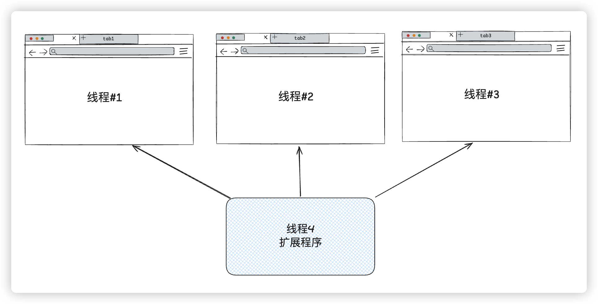

# 通信

## background、popup、content 通信

  

## 一次性消息发送

+ 如果要向扩展程序的另一部分发送一条消息，有两个 API 可供调用：

  + chrome.runtime.sendMessage(extensionId?, message) 向扩展程序的各个部分发消息（不但可以给自身扩展程序发消息，还能给别的扩展程序发消息，它发送的消息可以被扩展的任一部分接收到，包括 background，action popup，side panel，options page，devtools 等等）
  + chrome.tabs.sendMessage(tabId, message) 给某个浏览器的某个页签发消息

  

## 一次性消息接收

+ API

  ```js
  chrome.runtime.onMessage.addListener(
    (message, sender, sendResponse) => boolean | undefined
  )
  ```
