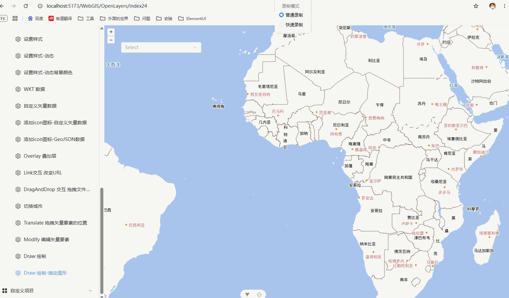

# Draw 绘制

## 概述

+ 用于绘制点、线、面、圆、多边形等

  

## API

+ `new Draw(options)`

+ 参数

  + source‌：绘制完成的要素要存放的数据源，必须配合一个 VectorLayer 才能在地图上显示

  + ‌type‌：绘制类型 必填项

    + Point 点(需要增加样式，不然看不到)

      ```js
      const vectorLayer = new VectorLayer({
        source: vectorSource,

        style: (feature) => {
          const name = feature.get("name");

          return new Style({
            stroke: new Stroke({
              color: "#FF0000",
              width: 2,
            }),
            fill: new Fill({
              color: "#FFFF0080",
            }),
            text: new Text({
              font: "16px sans-serif",
              fill: new Fill({
                color: "black",
              }),
              text: name,
            }),

            // 点的样式设置
            image: new Circle({
              radius: 7,
              fill: new Fill({ color: "#FFFF00" }),
              stroke: new Stroke({ color: "#FF0000", width: 2 }),
            }),
          });
        },
      });
      ```

    + LineString 线
    + Polygon 面
    + Circle 圆

  + ‌freehand‌：设为 true 时进入手绘模式，按住鼠标拖拽即可绘制，适合随手画草图

  + ‌clickTolerance‌：判断用户的行为是添加点，还是按住鼠标不松开进行拖拽地图。默认值是 6 像素，当按下鼠标和抬起鼠标左键之间的这段时间段内，如果地图被拖动没有超过 6 像素，那么默认为添加一个点，相反如果超过了 6 像素，那么不会添加点，只是平移一下地图

  + ‌snapTolerance‌：默认值是 12 像素。多边形第一个点和最后一个点的吸附判定范围

  + ‌minPoints：表示绘制单个要素最少的点数限制

  + maxPoints：表示绘制单个要素最多的点数限制

  + geometryName：设置绘制的要素的名称

  + ‌condition‌：自定义触发绘制的条件，比如加上权限校验：

    ```js
    condition: (event) => isApproved && noModifierKeys(event)
    ```

  + ‌freehandCondition‌：定义进入手绘模式的触发条件，默认是按住 Shift 键，也可以改成 ctrlKey && altKey 之类的组合键

  + ‌style‌：表示绘制的样式，如果没有设置样式，会使用上面Source对应的Layer的样式

  + wrapX：当地图水平显示多个相同位置时（缩放级别低的情况下会发生），是否显示多个勾绘任务。默认为false

  ```js
  import { Draw } from 'ol/interaction'

  // Polygon Circle LineString Point
  map.addInteraction(
    new Draw({
      type: 'Polygon',
      source: vectorSource,
    })
  )
  ```

## 监听事件

+ ‌drawstart‌：点击开始绘制时触发，event.feature 是正在绘制的要素，可以在这里监听它的 change 事件实现实时测量

+ ‌drawend‌：绘制完成时触发，event.feature 是最终生成的要素，可以在这里打标记、算面积或导出。

+ ‌drawabort‌：调用 abortDrawing() 中断绘制时触发，用得比较少

  ```js
  draw.on('drawend', (event) => {
    const feature = event.feature;
    feature.set('id', `draw_${Date.now()}`);
    feature.set('geometryType', drawType);
    // 后续可以在这里做测量、导出等操作
  });
  ```

## 常用操作技巧

+ ‌切换绘制类型必须重建‌：不能直接改 type 属性，需要先 `map.removeInteraction(draw)` 移除旧的，再创建新的 Draw 实例

+ ‌双击结束绘制且不放大地图‌：需要先移除默认的 DoubleClickZoom 交互，再监听 dblclick 事件移除 Draw

+ ‌撤销当前绘制‌：调用 `draw.abortDrawing()` ，它会中断当前绘制并且不保留草图

+ ‌绘制特殊形状‌：官方提供了 `createRegularPolygon(4)`（正方形）、 `createBox()` （矩形）等辅助函数，配合 geometryFunction 参数使用，椭圆等复杂形状也可以自定义几何函数实现

## 示例

+ 示例1 基本用法

  ```js
  import Draw from 'ol/interaction/Draw.js';
  import VectorSource from 'ol/source/Vector.js';

  const drawSource = new VectorSource();
  const draw = new Draw({
    source: drawSource,
    type: 'Polygon' // 'Point' | 'LineString' | 'Polygon' | 'Circle'
  });
  map.addInteraction(draw);
  ```

+ 示例2 扩展应用，利用下拉框选择绘制图形

  ```html
  <script setup>
    import { Draw } from 'ol/interaction'
    const options = [
      { value: 'Point', label: 'Point' },
      { value: 'LineString', label: 'LineString' },
      { value: 'Polygon', label: 'Polygon' },
      { value: 'Circle', label: 'Circle' },
    ]
    const value = ref('')
    watch(value, (newValue) => {
      if (!newValue) {
        return
      }
      if (map) {
        if (draw) {
          map.removeInteraction(draw)
        }
        draw = new Draw({
          source: vectorSource,
          type: newValue,
        })
        map.addInteraction(draw)
      }
    })
  </script>
  <template>
    <el-select v-model="value" placeholder="Select">
      <el-option v-for="item in options" :key="item.value" :label="item.label" :value="item.value" />
    </el-select>
  </template>
  ```
