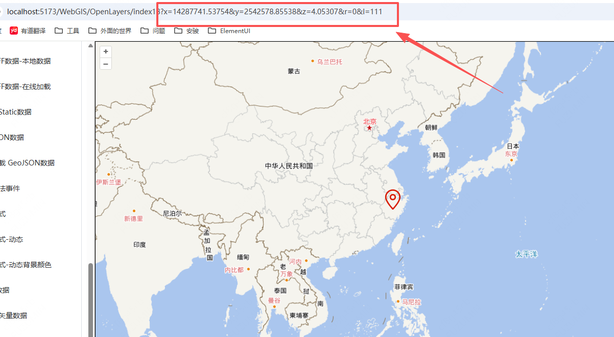

# Link 交互

## 概述

+ 作用：将地图的视图状态（中心点、缩放、旋转）实时同步到浏览器地址栏的 URL 中

+ 这样带来的好处是：

  + 可分享：用户可以直接复制地址栏链接，发给别人后打开就能看到完全一样的地图视角

  + 可前进/后退：浏览器的前进和后退按钮可以像操作网页一样，回退或前进到之前的地图视角

  + 可刷新恢复：刷新页面后，地图会保持在刷新前的视角，而不会重置

  

## API

+ API

  ```js
  import Link from 'ol/interaction/Link.js';

  const link = new Link({
    params: ['x', 'y', 'z', 'r'], // 可选，指定URL参数名
    replace: false,                // 可选，是否替换历史记录
    animate: false                 // 可选，是否使用动画过渡
  });

  map.addInteraction(link);
  ```

+ 参数

  + params：一个字符串数组，用于指定 URL 中使用的参数名。默认值为 `['x', 'y', 'z', 'r']`。你可以自定义这些名称，但数组顺序对应的是 `[x, y, z, r]`

    + x：中心点经度（或投影 X 坐标）

    + y：中心点纬度（或投影 Y 坐标）

    + z：缩放级别

    + r：旋转角度（弧度）

  + replace：布尔值

    + 默认 `false`
    + 如果设为 `true` 每次视图变化会用 `history.replaceState()` 替换当前历史记录，而不是新增一条
    + 适合频繁变化时避免历史记录堆积

  + animate：布尔值

    + 默认 `false`
    + 如果设为 `true` 通过 URL 参数恢复视图时会使用动画过渡

## 添加同步 与 移除同步

+ Link 是一个交互（Interaction），所以通过 `map.addInteraction(link)` 添加，而不是直接操作地图属性

+ 移除同步：调用 `map.removeInteraction(link)` 即可停止 URL 同步

## 与 View 的关系

+ Link 本质上是监听 View 的 change:center、change:resolution、change:rotation 事件，然后更新 URL；同时也会监听浏览器的 popstate 事件，在用户点击前进/后退时恢复视图

## 示例

+ 示例1 基础用法

  ```javascript
  import { Link } from 'ol/interaction'

  map.addInteraction(new Link());

  // 添加后，当用户平移、缩放地图时，URL 会自动变成类似：
  https://example.com/map?x=0&y=0&z=2&r=0
  ```

+ 示例2 自定义参数名

  ```js
  const link = new Link({
    params: ['lon', 'lat', 'zoom', 'rot']
  });
  map.addInteraction(link);

  // 此时 URL 会使用 lon、lat 等自定义参数名
  ```

+ 示例3 禁止记录历史

  ```js
  const link = new Link({
    replace: true // 使用 replaceState，不产生新的历史记录
  });
  ```
