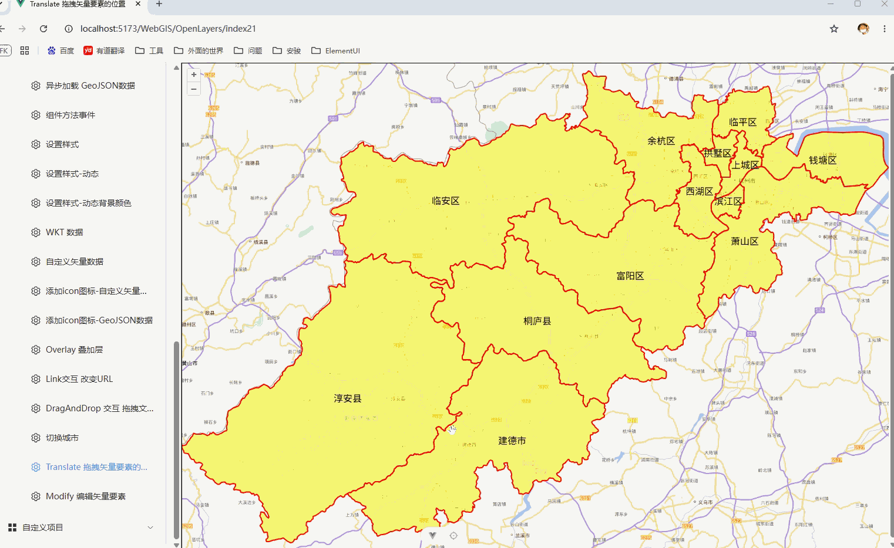

# Translate 拖拽矢量要素的位置

## 概述

+ OpenLayers 的 Translate 交互是用于平移（移动）地图矢量要素的核心交互之一
+ 它能让你通过鼠标拖拽或触摸操作，移动点、线、面等要素，是构建交互式地图编辑应用的基础

  

## 工作原理

+ Translate 交互属于 ol/interaction/Pointer 的子类，它通过监听地图上的鼠标或触摸事件，来检测并移动命中的要素

## 配置项

+ API `new Translate(options)`

+ 参数

  + ‌features‌：指定可拖动的要素集合（Collection），与 Select 配合时用 select.getFeatures() 即可

  + ‌layers‌：指定可拖动的图层，或者提供一个过滤函数

    + 不设置时默认所有可见图层都可拖动；如果设置了 features，此选项失效

  + ‌filter‌：一个过滤函数，接收 feature 和 layer，返回 true 才允许拖动

    + 可用于按属性限制，比如禁止拖动特定类型的要素

  + ‌hitTolerance‌：命中检测的像素容差，默认 0

    + 增大该值可以更容易点击到小要素，但数据量大时会明显增加计算量，导致交互卡顿，建议谨慎调大

  ```js
   import { Translate } from 'ol/interaction'

  // 对矢量图层添加修改交互，alt + click 可以删除顶点
  map.addInteraction(
    new Translate()
  )
  ```

## 事件监听

+ Translate 提供三个关键事件，可用于在拖动过程中或结束后执行自定义逻辑：‌‌

  + translatestart：开始拖动时触发

  + translating：拖动过程中持续触发

  + translateend：拖动结束时触发

  ```js
  translate.on('translateend', function(event) {
    const features = event.features; // 被拖动的要素集合
    console.log('拖动结束', features);
  });
  ```

## 实用技巧与注意事项

+ 性能优化‌：hitTolerance 和要素数量都会影响拖动流畅度。要素多或容差大时，每次鼠标移动都会遍历检测，容易卡顿。建议优先减小数据量或保持 hitTolerance 为 0

+ ‌约束移动范围‌：Translate 本身不限制移动区域，需要自行在 translateend 或 translating 事件中判断位置，超出范围时手动还原几何体

+ ‌与其他交互共存‌：Translate 可与 Modify（修改顶点）等交互同时使用，但要注意设置互斥的 condition 条件（如 Ctrl+Drag 触发平移），避免操作冲突

## 基本配置与初始化

+ 基本配置

  ```js
  // 1. 引入必要的模块
  import Map from 'ol/Map.js';
  import View from 'ol/View.js';
  import VectorLayer from 'ol/layer/Vector.js';
  import VectorSource from 'ol/source/Vector.js';
  import Translate from 'ol/interaction/Translate.js';
  import {fromLonLat} from 'ol/proj.js';

  // 2. 创建一个矢量图层（假设已包含要素）
  const vectorLayer = new VectorLayer({
    source: new VectorSource({
      // ... 从URL或数据加载要素
    })
  });

  // 3. 初始化地图
  const map = new Map({
    target: 'map',
    layers: [vectorLayer],
    view: new View({
      center: fromLonLat([0, 0]),
      zoom: 4
    })
  });

  // 4. 创建并添加Translate交互
  // 方式一：允许移动所有可见图层中的要素
  const translate = new Translate();
  map.addInteraction(translate);

  // 方式二：仅允许移动特定图层中的要素（推荐）
  const translateSpecific = new Translate({
    layers: [vectorLayer] // 仅允许移动vectorLayer中的要素
  });
  map.addInteraction(translateSpecific);

  // 方式三：使用过滤函数，仅移动满足条件的要素（如类型为'point'的要素）
  const translateFiltered = new Translate({
    layers: [vectorLayer],
    filter: function(feature, layer) {
      return feature.get('type') === 'point'; // 假设要素有'type'属性
    }
  });
  map.addInteraction(translateFiltered);
  ```
