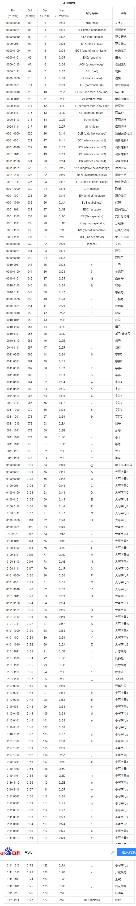

# ASCII字符集

## 概述

+ ASCII 上世纪60年代 是美国制定了一套字符编码（使用一个字节），对英文字符与二进制位之间的关系，做了统一规定
+ ASCII 一共规定了 128 个字符的编码，只占用了一个字节的后7位，最前面的一位统一规定为0

  + 实际上 一个字节可以表示 256个字符，但ASCII只使用128个字符

+ 确定

  + 不能表示所有字符

+ ASCII 字符集（一共包含 128 个字符）

  
