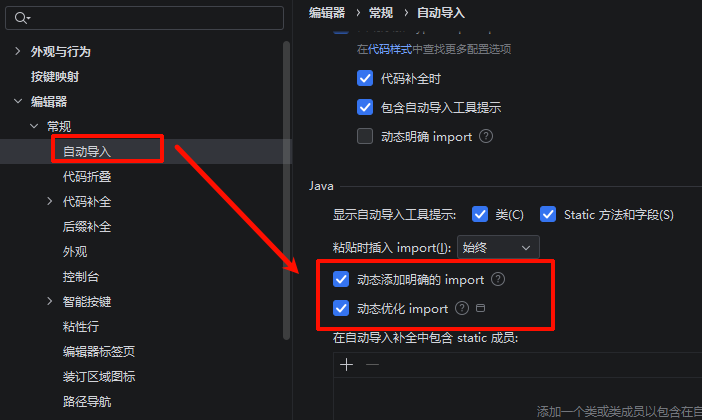

# 快捷键

## 快捷键

+ 补全代码 alt + /
+ 添加/取消注释 ctrl + /

+ 导入该行需要的类 先配置 auto import，然后使用 alt + enter 即可

  

+ 快速格式化 ctrl + alt + L

+ 快速运行程序 shift + F10

+ 生成构造器等 alt + insert

+ 查看一个类的层级关系 ctrl + H

+ 将光标放在一个方法上， 输入 ctrl + B，可以选择定位到那个类的方法

+ 自动的分配变量名，通过 在后面  xxx.var + enter

  ```java
  // 回车
  new Scanner(System.in).var
  ```
