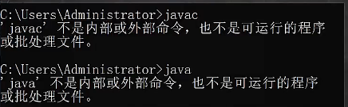
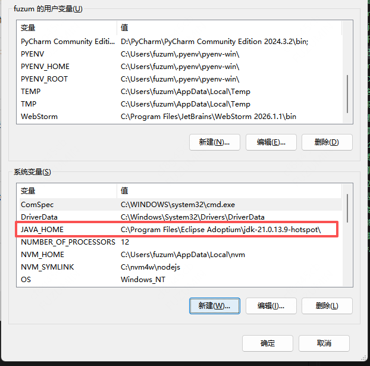
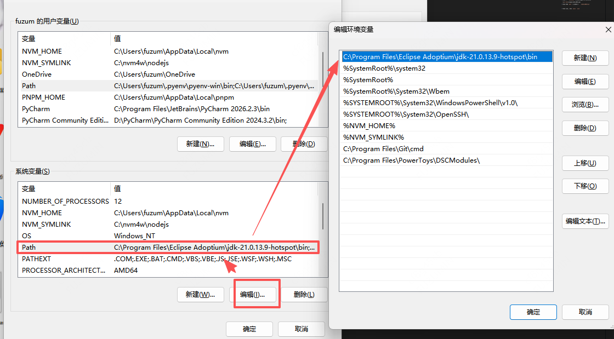

# 配置环境变量

## 为什么要配置 path

+ 在 doc 命令行中敲入 javac 出现错误提示

  

+ 原因

  +

## 配置环境变量

+ 步骤1 我的电脑 -> 属性 -> 高级系统设置 -> 环境变量
+ 步骤2 增加 `JAVA_HOME` 环境变量，指向 JDK 的安装目录

  

+ 步骤3 编辑 `path` 环境变量，增加 `%JAVA_HOME%\bin`

  

+ 步骤4 命令行 输入 `javac` `java`
