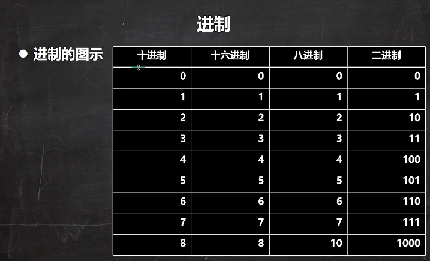
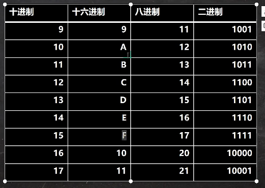

# 基础

## 对于整数有四种表示方式

+ 二进制： 0,1，满2进1，以 0b 或 0B 开头

  ```java
  int n1 = 0b1010;
  ```

+ 十进制： 0-9，满10进1

  ```java
  int n2 = 1010;
  ```

+ 八进制： 0-7，满8进1，以数字0开头表示

  ```java
  int n3 = 01010;
  ```

+ 十六进制： 0-9，A(10)-F(15)，满16进1，以0x或0X开头表示，A-F 不区分大小写

  ```java
  // 不区分大小写
  a // 10
  A // 10
  ```

  ```java
  int n4 = 0x10101;
  int n5 = 0X10101;
  ```

  
  
