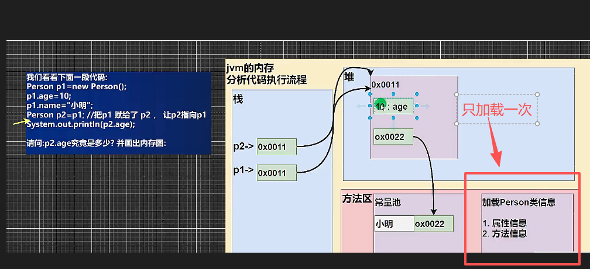

# 创建对象

## 方式1 先声明再创建

+ 先声明再创建

  ```java
  Cat cat; // 声明对象 car
  cat = new Cat(); // 创建
  ```

## 方式2 直接创建

+ 先声明再创建

  ```java
  Cat cat = new Cat();
  ```

## 创建对象流程

+ 示例

  ```java
  // 类定义
  class Student {
      // 属性（成员变量）
      String name;
      int age;
  }

  Cat cat = new Cat();
  cat.name = "str";
  p.age = 10;
  ```

+ 步骤1:加载 Cat 类的信息（属性和方法信息），只会加载一次

  + 多次 `new Cat()` 只会在第一次 new 的时候加载

  

+ 步骤2:在堆中分配空间，值进行默认初始化（参考数组默认值）
+ 步骤3:把堆中的地址给 cat，cat就指向对象
+ 步骤4:进行指定初始化

  ```java
  cat.name = "str";
  p.age = 10;
  ```

