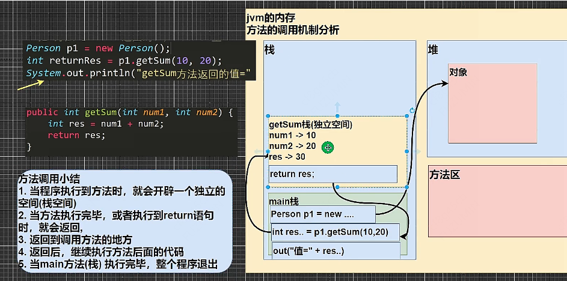

# 方法 或 成员方法

## 概述

+ 方法

  ```java
  // 类定义
  class Person {
      // 属性（成员变量）
      String name;
      int age;

      // 方法（行为） void表示无返回值
      public int getSum(int num1, int num2) {
          return num1 + num2;
      }
  }

  Person = p1 = new Person();
  int returnres = p1.getSum(10, 20);
  ```

## 定义

+ 语法

  ```java
  public 返回数据类型 方法名(形参列表) {
    // 执行语句
    return 返回值;
  }
  ```

+ 形参列表
+ 返回数据类型：表示成员方法输出， void 表示没有返回值
+ 方法主体：功能的实现
+ return 语句不是必须的

### 方法名

+ 小驼峰命名

### 方法体

+ 方法不能嵌套定义：方法体里面不能在定义方法

  ```java
   class AA {
      public void f1() {
          // 不允许
          public void f2() {

          }
      }
    }
  ```

### 返回类型

+ 一个方法最多有一个返回值

  + 如果需要返回多个结果，则可以返回数组

    ```java
    class AA {
      public int[] getSumAndSub(int n1, int n2) {
          int[] resArr = new int[2];
          resArr[0] = n1 + n2;
          resArr[1] = n1 - n2;
          return resArr;
      }
    }
    ```

+ 返回类型可以为任意类型，包含基础类型和引用类型（数组、对象）
+ 如果方法要求有返回数据类型，则方法体中最后的执行语句必须为 `return 值` ，而且要求返回值类型必须和return 的值类型一致或兼容

  ```java
  // 返回值类型一致
  class AA {
      public double f1() {
          double d1 = 1.1 * 3;

          return d1;
      }
  }

  // 兼容
  class AA {
      public double f1() {
          int n = 100;
          return n; // int 自动转换成 double
      }
  }

  // 错误-编译不能通过
  class AA {
      public int f1() {
          double d1 = 1.1 * 3;
          return d1; // 错误
      }
  }
  ```

+ 如果方法是 `void` ，则方法体中可以没有 `return` 语句，或者 只写 `return;`

  ```java
  // 不写
  class AA {
      public void f1() {

      }
  }

  // 写
  class AA {
      public void f1() {
          return;
      }
  }
  ```

## 方法调用

+ 同一个类中的方法调用：直接调用就行

  ```java
  class Person {
      void print(int n) {
          System.out.println("打印 " + n);
      }

      void sayOk() {
          print(10);
      }
  }
  ```

+ 跨类中的方法A类调用B类方法：需要通过对象名调用

  ```java
  class Person {
      void m1() {
          Person2 p2 = new Person2();
          p2.hi(10);
      }

  }

  class Person2 {
      void hi(int n) {
          System.out.println("打印 " + n);
      }

  }
  ```

## 方法的调用机制分析

+ 分析

  ```java
  // 类定义
  class Person {
      // 属性（成员变量）
      String name;
      int age;

      // 方法（行为） void表示无返回值
      public int getSum(int num1, int num2) {
          return num1 + num2;
      }
  }

  Person = p1 = new Person();
  int returnres = p1.getSum(10, 20);
  ```

  
