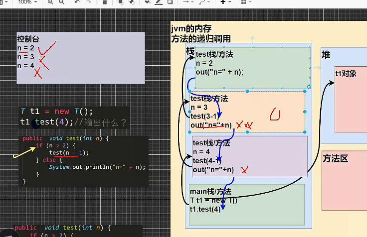

# 递归调用

## 概述

+ 递归就是方法自己调用自己
+ 每次调用时传入不同的变量
+ 递归有助于解决复杂问题

## 能解决什么问题

+ 数学问题：8皇后问题、汉诺塔、阶乘问题、迷宫问题、球和篮子问题
+ 各种算法也会用到递归：快排、归并排序、二分查找、分治算法等
+ 将用栈解决的问题--> 递归代码比较简洁

## 规则

+ 规则1：执行一个方式时，就创建一个新的受保护的独立空间（栈空间）

  

+ 规则2：方法的局部变量是独立的，不会相互影响
+ 规则3：如果方法中使用的是引用变量（比如数组），则就会共享该引用类型
+ 规则4：递归必须向退出递归的条件逼近，否则就会无限递归出现 `StackOverflowError`
+ 规则5：当一个方法执行完毕，或者遇到 return 就会返回，准时谁调用就将结果返回给谁，同时当方法执行完毕或者返回时，该方法就执行完毕

## 示例

+ 阶乘

  ```java
  class AA {
      int f1(int n) {
          if(n == 1) {
              return 1;
          }
          return f1(n - 1) * n;
      }
  }
  ```
