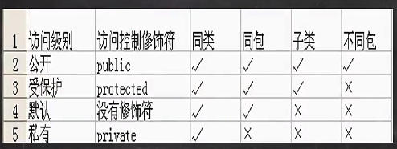

# 访问修饰符

## 概述

+ 用于控制 属性 和 方法 的访问权限（访问）
+ 也可以用于修饰类本身

  ```java
  public class Pp {

  }
  ```

## 分类

+ `public` 对外公开
+ `protected` 受保护 对子类和同一个包中的类公开
+ 默认（没有写修饰符） 向同一个包的类公开
+ `private` 私有，只有类本身可以访问，不对外

  

## 权限大小

+ `public` > `protected`  > 默认 > `private`
