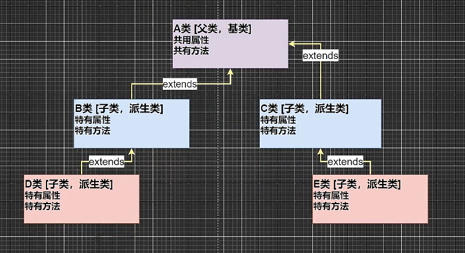
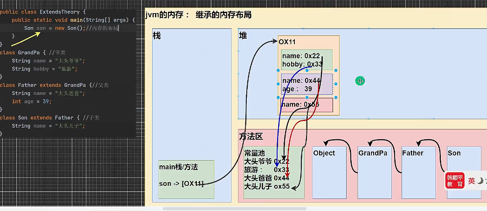

## 继承

## 作用

+ 集成可以解决代码的复用
+ 让我们的编程国家靠近人类思维，当多个类存在相同的属性和方法是，可以从这些类中抽象出父类，在父类中定义这些相同的属性和方法
+ 所有的子类不需要重新定义这些属性和方法，只需要通过 `extends` 来声明继承父类即可

  

## 优点

+ 代码的复用性提高了
+ 代码的扩展和维护性提高了

## 继承的本质

+ 当子类对象创建好了之后，建立查找的关系

  ```java
  // 属性查找关系
  1. 查看子类是否有该属性
  2. 如果子类有该属性，并且可以访问，则返回属性信息
  3. 如果子类没有该属性，则查看父类是否有该属性（如果父类有该属性，并且可以访问，则返回属性信息）
  4. 继续执行 3
  // 直到 Object
  ```

  

## 语法

+ 语法

  ```java
  class 子类 extends 父类 {

  }
  ```

+ 子类会自动拥有父类定义的属性和方法
+ 父类又叫 超类 基类
+ 子类又叫派生类

## 注意点

+ 子类继承了父类的所有属性和方法

  + 非私有的属性和方法可以直接在子类中访问
  + 私有的属性和方法不能在子类中直接访问，要通过父类提供的公共的方法去访问

+ 子类必须调用父类的构造器，完成父类的初始化

  ```java
  // 子类
  class Sub extends Base {
      // 无参构造器
      public Sub() {
          super(); // 系统会默认调用父类的无参构造器
          // ...
      }
  }

  ```

+ 当创建子类对象时，不管使用子类的那个构造器，默认情况下总会去调用父类的无参构造器，如果父类没有提供无参构造器，则必须在子类的构造器中使用 `super` 去指定使用父类的那个构造器完成对父类的初始化工作，否则编译不会通过

  ```java
  // 父类
  class Base {
    public String name;

    public Sub() {}

    public Sub(String name) {
      this.name = name;
    }
  }

  // 子类
  class Sub extends Base {
      // 无参构造器
      public Sub() {
          super(); // 系统会默认调用父类的无参构造器
          // ...
      }

      // 有参构造器
      public Sub(String name) {
          super(name); // 主动调用有参构造器
          // ...
      }
  }
  ```

+ 如果希望指定去调用父类的某个构造器，则需要显示的调用一下 `super(参数列表);`

+ `super` 在使用的时候，必须放在构造器的第一行（`super` 只能在构造器中使用）

+ `super()` 和 `this` 都只能放在构造器的第一行，因此这两个方法不能在一个构造器里共存

  ```java
  class Sub extends Base {
      // 无参构造器
      public Sub() {
          super(); // 系统会默认调用父类的无参构造器
          this("12"); // 错误不被允许
      }

      // 有参构造器
      public Sub(String name) {
          super(name); // 主动调用有参构造器
          // ...
      }
  }
  ```

+ java 所有的类都是 Object 类的子类（快捷键 ctrl + b 查看）

  

+ 父类构造器的调用不限于直接父类，将一直往上追溯到 Object 类（顶级父类）

+ 子类最多只能继承一个父类（直接继承），即java是单继承机制

  ```java
  // A 类 继承 B类和C类

  class B extends C {}

  class A extends B {
    // 现在存在 C 的属性和方法
    // 现在存在 B 的属性和方法
  }
  ```

+ 不能滥用继承，子类和父类之间必须满足 is-a 的逻辑关系
