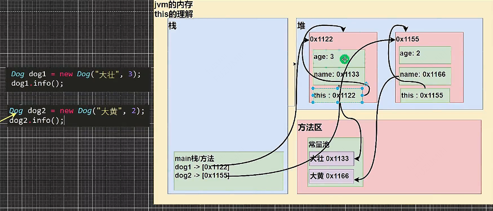

# this

## 概述

+ java 虚拟机 会给每个对象分配 this，代表当前对象

+ 那个对象调用 this ，this就代表那个对象

  

+ this 关键字可以用来访问本类的属性、方法、构造器

  ```java
  class Person {
      int age = 0;

      public void f1() {
        int a = this.age;
        // ...
      }

      public void f2() {
        this.f1();
      }
  }
  ```

+ this 用来区分当前类的属性和局部变量

+ 访问成员方法的语法 `this.方法名(参数列表)`

+ 访问构造器的语法：`this(参数列表);` 注意只能在构造器中访问另外一个构造器

  + `this(参数列表);` 必须放在第一条

  ```java
  class Person {
      String name;
      int age = 0;

      // 构造器1
      public Person() {
          // 访问另外一个构造器
          this("小明")
      }

      // 构造器2
      public Person(String n) {
          this.name = n;

          // ....
      }
  }
  ```

+ this 不能在类定义的外部使用，只能在类定义的方法中使用
