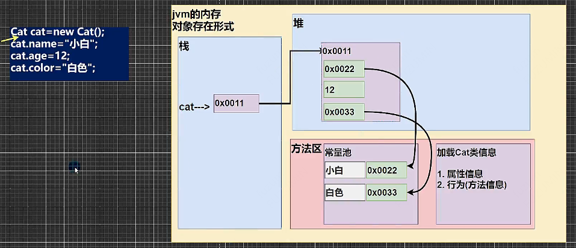
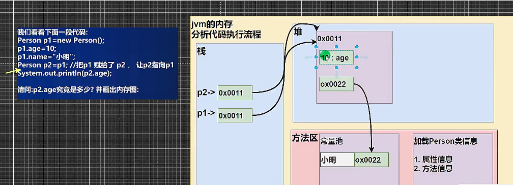

# 对象分配机制

## 内存布局

+ new 在堆上分配对象

  

+ 引用变量在栈上保存对象地址

+ 多个引用可指向同一对象，修改互相可见

  ```text
  栈（Stack）               堆（Heap）
  ┌─────────────┐          ┌──────────────────────┐
  │ s (引用)    │ ───────> │ Student 对象         │
  │ 0x001       │          │ name="张三", age=20  │
  └─────────────┘          └──────────────────────┘
  ```

  ```java
  Student a = new Student();
  Student b = a;        // b 与 a 指向同一对象
  b.name = "李四";
  System.out.println(a.name);  // 李四
  ```

  

## 步骤

+ 示例

  ```java
  class Person {
      int age = 90;
      String name;

      Person(String n, int a) {
        this.name = n;
        this.age = a;
      }
  }

  Person p = new Person("小明", 18);
  ```

+ 步骤1:加载 Person 类信息（Person.class），只会加载一次
+ 步骤2:在堆中分配空间（地址）
+ 步骤3:完成对象初始化

  ```java
  //3.1 默认初始化
  age = 0;
  name = null;

  // 3.2 显示初始化
  age = 90;
  name = null;

  // 3.3 构造器初始化
  age = 18;
  name = "小明"
  ```

+ 步骤4:在对象在堆中的地址返回给 p（p是对象名，也可以理解成是对象的引用）
