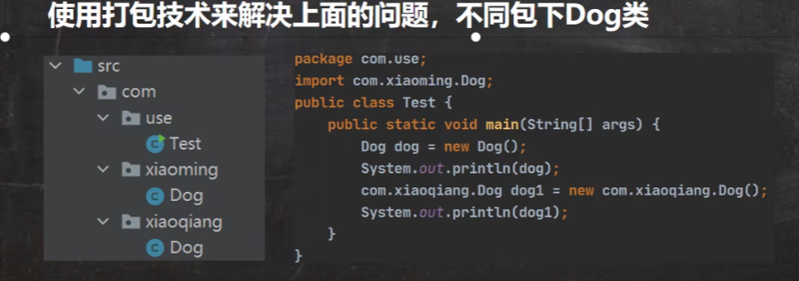
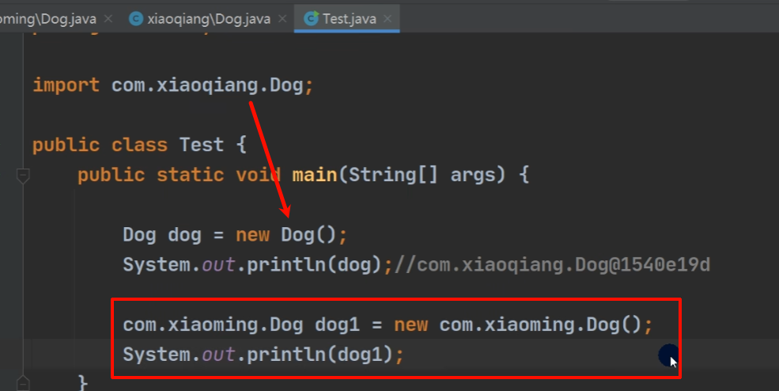

# 基础

## 作用

+ 区分相同名字的类
+ 当类很多时，可以很好的管理类
+ 控制访问访问

## 包的本质

+ 创建不同的文件夹/目录来保存类文件

  

  

## 不同包引用同一个类名的使用方式

+ 在当前文件中使用不同包下的类（类名字相同）

  

## 基本语法

+ `package com.hspedu;`

+ `package` 关键字 表示打包
+ `com.hspedu` 表示包名

## 引入包

+ `import 包;`

  ```java
  // 指定引入包下的具体类
  import java.util.Scanner;

  // 将包下的所有类都引入
  import java.util.*;
  ```

## package 与 import

+ package 的作用是什么当前类所在的包，需要放在 class 的最上面，一个类最多只有一句 package
+ import 指令放在 package 的下面，在类定义的前面，可以有多条，同时没有顺序要求

  ```java
  package com.xiaoqiang;

  import java.util.Arrays;

  public class Dog {

  }
  ```
