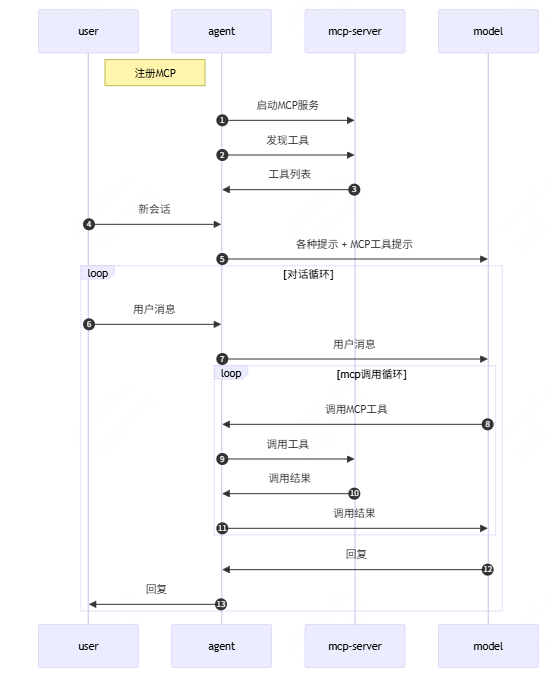
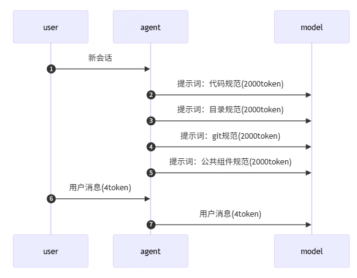
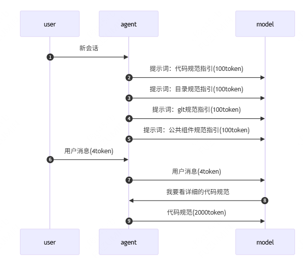

# Coding Agent原理

## tools

+ 给大模型发送

  ```
  总结一下这个项目在干什么 ---> 大模型 ---> ????

  // 大模型一般不知道怎么回答
  ```

+ Coding Agent

  + 加提示词

    + 告诉大模型，目前项目代码的路径

      ```md
      // 例如
      当前项目地址 E:\Github\Note\AI\AI效能工具，请总结当前项目是在做什么
      ```

    + 告诉大模型，可以使用哪些工具

      ```md
      // 例如
      当前项目地址 E:\Github\Note\AI\AI效能工具，请总结当前项目是在做什么，你可以使用以下工具
      1. command:通过这个工具可以检查某个目录下的子文件和子文件夹
      2. read: 通过这个工具可以读取某个文件的内容，使用这个工具需要传入文件路径

      你当前所在目录 E:\Github\Note\AI\AI效能工具

      你需要根据情况判断是否需要使用这些工具，如果要使用工具请使用 JSON 格式输出，如果不使用则正常输出
      ```

  + 将用户问题和提示词一起传递给大模型
  + 大模型根据情况决定是否要使用工具。当需要使用工具的时候，它会返回一个JSON格式
  + Agent, 它就会拿到这个JSON格式，然后根据JSON格式的内容决定接下来如何处理?
  + Agent将执行的结果，然后返回给模型，又输入给大模型
  + 后续呢，继续交互性的操作，就大模型跟Agent之间不停的交互，直到得得到一个最终的答案

+ 常用工具：

  + command 执行命令
  + read 读文件
  + write 写文件
  + delete 删除文件

## 会话

+ conversation / session / thread

+ 在同一个会话里边，每一次对话都要把之前的所有历史消息内容全部带上

## 提示词

+ 每一次会话（非对话）会带上提示词，尽量保持精简
+ 增加提示词的目的：减少上下文（模型会读取工程文件，理解每个文件的作用，使用 tools 的时候会反复和模型沟通，增加大量的上下文，上下文过多，模型会出现幻觉）

+ 全局提示词

  ```md
  // 例如
  1. 包管理器始终使用 pnpm，除非特别要求
  2. 不确定的问题一定要向用户提问，不要自行决定
  ```

+ 工程提示词（内容：工程描述）

  ```md
  # 工程简要说明

  ## 重点

  1. 每一次对工程的改动都需要思考是否要改动本文件内容
  2. 每一次对 `scr/components` 中的任何修改，都必须同步更新 `docs/components` 下的对应文档，同时检查是否需要更新 `Claude.md` （如组件索引）。此操作无需询问用户

  此文件内容应该用于和工程对应！

  ## 开发规范

  + 保持代码质量，铭记关注点分离原则，一个文件不应该有太多的代码，也不应该有太多的功能
  + 比如组件仅处理逻辑，不应该有其他逻辑（如数据处理、状态管理）

  ## 系统功能

  + 首页：全屏展示欢迎图片
  + ...

  ## 技术栈

  + 构建 vite 7.3.2
  + 前端： vue3、vue-route、pina
  + UI：Element-plus 2.9.7
  + 包管理 pnpm(engines: node 24.19.0 / pnpm 11.22.0)

  ## 目录结构（关键路径）

  + /pubic/articles:
  + /src/assets: 静态资源
  + /src/main.ts: 应用入库、全局样式引入
  + /src/routes/index.ts 路由表（与页面懒加载）
  + /src/App.vue 全局布局（Layout + 左侧菜单）
  + /src/Home.vue 首页
  + /src/Test/index.vue xxx页
  + /src/xx/xxx.vue xxx页
  + /scr/styles/style.css、/scr/styles/math.css 样式

  ## 开发构建

  + 安装依赖 pnpm install
  + 本地开发 pnpm run dev
  + 本地预览 pnpm run preview
  + 注意

    + 包管理统一使用 pnpm
    + Node 版本建议遵循 package.json 中的 devEngines.runtime.version 中的配置

  ## 路由与布局

  + 基础路由

    + /: 首页
    + /xxx: xx页

  + 布局

    + 使用 Element-plus Layout

  ## git 提交规范（每次修改完都要提交）

  + 要求：完成每个独立变更后立即提交，保持提交颗粒度小而清晰
  + 建议遵循 Conventional Commits:

    + feat: 新功能
    + fix: 修复缺陷
    + refactar: 重构（无功能变更）
    + docs: 文档变更（如本文件）
    + style: 代码风格调整
    + chore: 构建/依赖/脚手架

  + 示例

    + feat: 添加左侧菜单并适配移动端收起
    + fix: 修复浅色主题下侧边栏背景错误
    + docs: 新增工程说明到 CLAUDE.md

  ## 组件文档索引

  + 当需要详细了解一下组件的使用方法时，请参考对应的文档路径

  + AdditionExplaim : 加法交换律演示组件，通过动画展示数字交换。[文档](/docs/components/AdditionExplaim.md)

  ## 其他说明

  + UI开发统一优先使用 Element-plus 组件
  + 文章资源位于 public/articles 构建后作为静态资源提供
  + 仓库约束

    + 包管理仅使用 pnpm
    + 不得提交密钥等敏感信息
    + 不删除根目录 prompt-doc 及其文件
  ```

## 深度思考 / 推理 / 思维链

+ 与模型的交互

  ```md
  用户问题 + 提示词 ---> 模型 ---> 回复
  ```

+ 解决办法

  ```md
  用户问题 ---> 模型 ---> 思考过程 ---> 模型 ---> 确定性更高的回复
        |                            |
        |-----------------------------
          用户问题 + 思考过程 一起给模型（相当于自己给自己提示词）
  ```

## MCP

+ 可以简单的理解为：MCP就是一个tool的集合

  

+ 优点：一次性完成
+ 缺点：上下文过大

+ 替代方法： cli (渐进式工具)

## Skill

+ 它第一次引入了渐进式提示方案
+ Skill 最初要解决的问题是提示词过大的问题

+ 优点：上下文过大
+ 缺点：动态处理程序

+ 示例 一个最小可用的 SKILL.md 示例

  + 格式限制

    + frontmatter 必须包含 name 和 description，缺失时该技能会被忽略，并在设置页的诊断里给出原因。
    + description 上限 1024 字符。超出后整个技能会被丢弃（诊断显示「description 超过 1024 字符」），不是截断——请把长说明放进正文。
    + SKILL.md 正文超过 100KB 时会被截断加载

  ```md
  ---
  name: code-review-checklist
  description: Review code changes with a focused checklist for correctness, regressions, tests, and maintainability.
  ---

  # Code Review Checklist

  Use this skill when reviewing a pull request, merge request, or local diff.

  Focus on correctness, regressions, missing tests, risky API changes, and maintainability.
  ```

+ 无渐进式方案

  

+ 渐进式方案

  

+ skill 存放位置

  + 工程级 `.agents/skils/xxx`

    ```
    // 例如
    .agents/skils/jokes/SKILL.md
    .agents/skils/find-skills/SKILL.md
    ```

  + 全局级

+ skill商店：https://skills.sh/

## Sub Agent 子代理

+ 子代理拥有独立的：提示词、会话上下文[、skills、tools、权限边界...]

+ 子代理的优势：

  + 独立会话，不污染主代理上下文
  + 可并行执行，缩短任务总时长
  + 能力专注，更适合专项任务

+ Coding Agent一般会有两种形式的子代理：

  + 内置子代理：系统内置的代理，不同厂商设置不同，用户无法干预
  + 用户子代理：用户启动的子代理，通常用于完成各种并行、独立的开发任务，需要用户用提示词启动

## 长期记忆

+ Coding Agent 有内置的长期记忆系统，会记录和用户的沟通过程中沉淀的经验和教训
